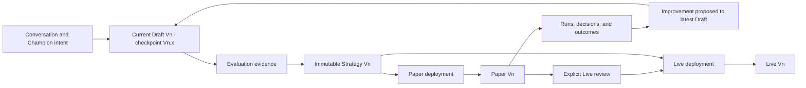

# Vantheon Product and Frontend Architecture

This repository is the architecture handbook for Vantheon's Champion workspace: a conversation-driven environment for creating strategies, testing them in Paper, iterating from evidence, and deliberately promoting Paper-tested strategies to Live capital.

The handbook aligns product, design, and frontend engineering. It defines user journeys, information architecture, conceptual entities, client-state ownership, lifecycle behavior, accessibility, performance validation, and the reasoning behind accepted decisions. It intentionally stops short of prescribing production database schemas or exact backend payloads.

## Governing outcome

> Minimize the distance from intent → strategy → evidence → iteration, while making every transition involving capital explicit, explainable, and controlled.

Strategy and configuration changes may be reversible. Executed trades are not.

## Priority journeys

Planning and delivery optimize two journeys in order:

1. **Onboarding to value** — a new user reaches an understandable strategy, credible initial evidence, and a safely running Paper portfolio with minimal setup.
2. **Rigorous iteration** — a user traces observed behavior to its cause, improves the current Draft, evaluates the change, and compares new evidence without changing anything already running.

See [Priority User Journeys](docs/priority-user-journeys.md) for the governing stages, trust gates, recovery paths, measures, and vertical delivery slices.

## Core product model

The essential invariants are:

- A **Champion** is the persistent AI agent identity; its workspace and strategy lineage are related but distinct concepts.
- One current `Draft Vn` is mutable. Each accepted semantic Draft change set creates one restorable minor checkpoint such as V5.2, regardless of its authorized initiator.
- Launching Paper freezes an immutable major strategy, pins Paper to it, and begins the next Draft generation independently.
- Multiple Paper portfolios coexist so evidence can accumulate and be compared over time.
- A portfolio is persistent; a run is one execution inside it.
- Paper and Live strategies never change because of Draft editing or conversation.
- Conversation may carry Paper or Live context, but strategy changes always target the current Draft and the UI states that target explicitly.
- Live follows Paper evidence and requires an explicit capital-impact review and confirmation.

## Reading order

Read in this order when joining the project or making a cross-cutting change:

1. [Product Foundations](docs/product-foundations.md) — outcomes, terminology, trust ladder, principles, and measures.
2. [Priority User Journeys](docs/priority-user-journeys.md) — the two flows the product must optimize.
3. [Information Architecture](docs/information-architecture.md) — workspace hierarchy, navigation, context, and progressive disclosure.
4. [Domain Model](docs/domain-model.md) — entities, relationships, invariants, and provenance.
5. [State Diagrams](docs/state-diagrams.md) — lifecycle, command, promotion, reconnect, and performance flows.
6. [Frontend Architecture](docs/frontend-architecture.md) — stack, state ownership, streaming, caching, recovery, security, and testing boundaries.
7. [UI Component Architecture](docs/ui-component-architecture.md) — stock shadcn boundaries and the customization-safe component model.
8. [Accessibility and Motion](docs/accessibility-and-motion.md) — WCAG target, keyboard/focus behavior, live data, chart alternatives, and safe motion.
9. [Performance Simulation](docs/performance-simulation.md) — deterministic load, browser instrumentation, correctness oracles, and CI tiers.
10. [Decision Ledger](docs/decisions.md) — accepted, proposed, and deferred choices with their reasoning and revisit triggers.

[PLAN.md](PLAN.md) is the working documentation plan and completion checklist. It is not the canonical source when a dedicated document provides a more specific rule.

## Decision status

- **Accepted** — governs current design and implementation.
- **Proposed** — needs an explicit decision before dependent work begins.
- **Deferred** — intentionally excluded until a recorded trigger occurs.
- **Superseded** — retained for history but replaced by another decision.

If documents disagree, use this precedence:

1. Accepted entry in the [Decision Ledger](docs/decisions.md).
2. Explicit invariant in the relevant domain or journey document.
3. More specific document over a general summary.
4. [PLAN.md](PLAN.md) as the least specific working source.

Resolve contradictions by updating all affected documents in the same change.

## Frontend architecture at a glance

- One React/TypeScript application using Next.js App Router and persistent layouts.
- TanStack Query for server-backed read models and indexes.
- Zustand for local interaction state and non-authoritative projections.
- IndexedDB/Dexie for pending-command recovery, never canonical business state.
- An external subscription store and narrow subscriptions for high-frequency telemetry.
- AI data streams for conversational presentation; validated server commands and patches for authority.
- WebSocket streams for market, portfolio, and Champion events.
- Stock shadcn primitives behind stable system and domain component boundaries.
- Lightweight Charts initially, with accessible textual equivalents.
- Deterministic backend simulation and real-browser event-to-paint measurement before speculative optimization.

## Scope

This handbook covers:

- User outcomes, trust, and product terminology.
- Champion workspace information architecture.
- Frontend-facing entities, provenance, and lifecycle behavior.
- State ownership and authoritative data flow.
- Component, streaming, caching, recovery, accessibility, motion, and security boundaries.
- Performance and correctness simulation.
- Decision rationale and revisit conditions.

It does not define:

- Production database tables or migration strategy.
- Exact REST, WebSocket, or AI-stream payloads.
- Brokerage integration details or execution algorithms.
- Legal, regulatory, suitability, or jurisdiction-specific requirements.
- A final branded visual system.
- Numeric performance or time-to-value targets before representative baselines exist.

Those artifacts must conform to the invariants and frontend-facing contracts in this handbook when they are created.

## How to review a change

Before accepting a product, design, or architecture change, verify:

- Which priority journey and stage does it improve?
- Does it shorten time to useful evidence or improve the rigor of iteration?
- Are viewed context, mutation target, and authoritative state unmistakable?
- Can every outcome still trace to the exact run and immutable strategy responsible?
- Does failure leave Draft, Paper, Live, and capital in a safe, understandable state?
- Does it preserve keyboard, screen-reader, reduced-motion, and non-color access?
- Has its performance effect been measured under a reproducible scenario?
- Does it change an accepted decision or trigger a deferred one?

For pull requests, `GEMINI.md` supplies repository-specific AI-review guidance. AI review and automated checks are evidence; human owners remain accountable for financial semantics and Live-capital safety.
