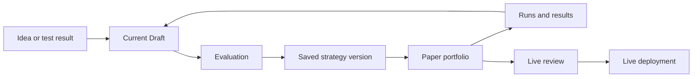

# Vantheon

Vantheon is a prototype trading workspace. Users work with an AI agent, called a Champion, to draft a strategy, test it in a simulated Paper portfolio, review the results, and decide whether it is ready for a Live review.

This repository contains the frontend and the product and architecture docs behind it. It is not an exchange and does not place real trades.

## What I worked on

I mapped the main user flows, designed the workspace structure, defined how strategy versions and test results relate, and set rules for changes that could affect real money. The docs also cover frontend state, accessibility, performance, and testing.

The two main flows are:

1. **Getting started:** A new user creates a strategy, sees initial evidence, and starts a Paper portfolio.
2. **Improving a strategy:** A user reviews what happened in Paper, changes the Draft, tests it again, and compares the results without changing anything already running.

[Read the full user journeys](docs/priority-user-journeys.md).

## Strategy lifecycle



The Draft can change. A strategy already running in Paper or Live cannot change just because someone edits the Draft or talks to the Champion. Starting Paper saves a new strategy version. Moving toward Live requires a separate review and confirmation.

Other rules matter too:

- Each Champion has its own workspace. Switching Champions must not carry a change or action into the wrong workspace.
- A Paper portfolio can have many runs. Each result must link back to the exact strategy version that produced it.
- Restoring an old Draft checkpoint creates a new checkpoint. It does not erase history.
- The AI agent can suggest actions, but server checks decide whether an action may change business state.
- A Live review must show the evidence and the effect of the change before a user confirms it.

## Read the docs

Start with these if you want to understand the product:

1. [Product foundations](docs/product-foundations.md): goals, terms, and measures
2. [User journeys](docs/priority-user-journeys.md): the two main flows
3. [Information architecture](docs/information-architecture.md): workspace layout and navigation
4. [Domain model](docs/domain-model.md): strategies, portfolios, runs, and their history
5. [State diagrams](docs/state-diagrams.md): lifecycle and recovery flows

For implementation details:

6. [Frontend architecture](docs/frontend-architecture.md): state, streams, caching, and tests
7. [Champion runtime safety](docs/champion-runtime-safety.md): AI tool limits and server validation
8. [Charting architecture](docs/charting-architecture.md): chart engines and accessible data views
9. [UI component architecture](docs/ui-component-architecture.md): component boundaries
10. [Accessibility and motion](docs/accessibility-and-motion.md): keyboard, screen reader, and motion rules
11. [Performance simulation](docs/performance-simulation.md): repeatable load tests
12. [Development testing checkpoints](docs/development-testing.md): hands-on test gates
13. [Decision ledger](docs/decisions.md): accepted, proposed, and deferred decisions

[PLAN.md](PLAN.md) records earlier planning. For current choices, use the accepted entries in the decision ledger and the relevant product docs.

## Frontend

The frontend uses Next.js, React, and TypeScript. TanStack Query handles server data. Zustand handles local UI state. Dexie stores pending commands for recovery, but the server remains the source of truth. WebSocket streams bring in market and portfolio updates. Charts use Lightweight Charts and Visx.

Run it locally:

```bash
nvm use
npm install
npm run dev
```

Check the project before committing:

```bash
npm run check
npm run build
```

`npm run charts:check` keeps the two chart libraries in separate rendering modules.

## Scope and limits

The docs describe the product model and frontend rules. They do not define a production database, exact API payloads, brokerage integration, trading algorithms, or legal requirements. Those need separate work before this could become a real trading product.

When reviewing a change, check which user flow it helps, whether results remain tied to the right strategy version, what happens on failure, and whether the change works with a keyboard and screen reader. Measure performance with a repeatable test rather than a guess.
