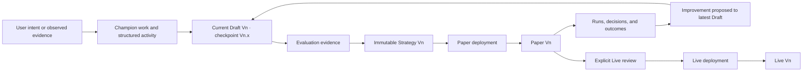

# Vantheon Product and Frontend Architecture

This repository is the architecture handbook for Vantheon's Champion workspace: an artifact- and evidence-centered research instrument where users direct a Champion, develop structured strategies, test them in Paper, iterate from outcomes, and deliberately promote Paper-tested strategies to Live capital. It is part lab notebook, part version-control client, and part observability tool—not an exchange or chat application. Conversation stays continuously visible in a secondary dock beside the work, but it is not the application shell or source of truth.

The handbook aligns product, design, and frontend engineering. It defines user journeys, information architecture, conceptual entities, client-state ownership, lifecycle behavior, accessibility, performance validation, and the reasoning behind accepted decisions. It intentionally stops short of prescribing production database schemas or exact backend payloads.

## Governing outcome

> Minimize the distance from intent → strategy → evidence → iteration, while making every transition involving capital explicit, explainable, and controlled.

Strategy and configuration changes may be reversible. Executed trades are not.

## Priority journeys

Planning and delivery optimize two journeys in order:

1. **Onboarding to value** — a new user reaches an understandable strategy, credible initial evidence, and a safely running Paper portfolio with minimal setup.
2. **Rigorous iteration** — a user traces observed behavior to its cause, improves the current Draft, evaluates the change, and compares new evidence without changing anything already running.

See [Priority User Journeys](docs/priority-user-journeys.md) for the governing stages, trust gates, recovery paths, measures, and vertical delivery slices.

## Core product model



The essential invariants are:

- A **Champion** is the persistent AI agent identity; its workspace and strategy lineage are related but distinct concepts.
- Champion selection is the shell-level parent of Draft, Paper, Live, conversation, and domain context; switching restores that Champion's workspace without carrying mutation targets or references across identities.
- The active strategy, evidence, run, comparison, or risk surface is primary. Conversation directs and explains work but never becomes its only representation.
- After a structured Draft exists, the desktop shell uses an environment navigator, fluid workbench, contextual inspector, and test/run output tray; onboarding is an empty state rather than the permanent layout.
- One current `Drafting Vn` is mutable. Its latest saved state is displayed as `Checkpoint m`; canonical records may retain compound identity `Vn.m` for provenance.
- Launching Paper freezes an immutable major strategy, pins Paper to it, and begins the next Draft at checkpoint `Vn+1.0` as an exact content clone of the launched checkpoint.
- Restoring an earlier checkpoint never rewinds history; after review and validation it creates the next checkpoint with the restored content.
- Multiple Paper portfolios coexist so evidence can accumulate and be compared over time.
- A portfolio is persistent; a run is one execution inside it.
- Paper and Live strategies never change because of Draft editing or conversation.
- Conversation may carry Paper or Live context, but strategy changes always target the current Draft and the UI states that target explicitly.
- Paper launch uses server validation and explicit user confirmation, not an eligibility verdict. Live eligibility remains a versioned, server-authoritative assessment with visible criteria that the Champion may explain but cannot grant or override.
- Live follows Paper evidence and requires an explicit capital-impact review and confirmation.
- Champion inputs and model outputs are untrusted. Only capability-scoped commands that pass independent server validation may change business state.

## Reading order

Read in this order when joining the project or making a cross-cutting change:

1. [Product Foundations](docs/product-foundations.md) — outcomes, terminology, trust ladder, principles, and measures.
2. [Priority User Journeys](docs/priority-user-journeys.md) — the two flows the product must optimize.
3. [Information Architecture](docs/information-architecture.md) — workspace hierarchy, navigation, context, and progressive disclosure.
4. [Domain Model](docs/domain-model.md) — entities, relationships, invariants, and provenance.
5. [State Diagrams](docs/state-diagrams.md) — lifecycle, command, promotion, reconnect, and performance flows.
6. [Frontend Architecture](docs/frontend-architecture.md) — stack, state ownership, streaming, caching, recovery, security, and testing boundaries.
7. [Champion Runtime Safety](docs/champion-runtime-safety.md) — untrusted-input boundaries, scoped tools, independent validation, model evaluation, and incident controls.
8. [Charting Architecture](docs/charting-architecture.md) — engine boundaries, semantic adapters, loading, accessibility, and performance contracts.
9. [UI Component Architecture](docs/ui-component-architecture.md) — stock shadcn boundaries and the customization-safe component model.
10. [Accessibility and Motion](docs/accessibility-and-motion.md) — WCAG target, keyboard/focus behavior, live data, chart alternatives, and safe motion.
11. [Performance Simulation](docs/performance-simulation.md) — deterministic load, browser instrumentation, correctness oracles, and CI tiers.
12. [Development Testing Checkpoints](docs/development-testing.md) — founder test gates for onboarding, iteration, Live safety, performance, and release readiness.
13. [Decision Ledger](docs/decisions.md) — accepted, proposed, and deferred choices with their reasoning and revisit triggers.

[PLAN.md](PLAN.md) is retained as planning history and a traceability checklist. It is not a normative source.

## Decision status

- **Accepted** — governs current design and implementation.
- **Proposed** — needs an explicit decision before dependent work begins.
- **Deferred** — intentionally excluded until a recorded trigger occurs.
- **Superseded** — retained for history but replaced by another decision.

If documents disagree, use this precedence:

1. Accepted entry in the [Decision Ledger](docs/decisions.md).
2. Explicit invariant in the relevant domain or journey document.
3. More specific document over a general summary.
4. [PLAN.md](PLAN.md) only as historical planning context.

Resolve contradictions by updating all affected documents in the same change.

## Frontend architecture at a glance

- One React/TypeScript application using Next.js App Router and persistent layouts.
- TanStack Query for server-backed read models and indexes.
- Zustand for local interaction state and non-authoritative projections.
- IndexedDB/Dexie for pending-command recovery, never canonical business state.
- An external subscription store and narrow subscriptions for high-frequency telemetry.
- AI data streams for conversational presentation; validated server commands and patches for authority.
- WebSocket streams for market, portfolio, and Champion events.
- Stock shadcn primitives behind stable system and domain component boundaries.
- Lightweight Charts for streaming financial series and Visx for bespoke analytical evidence, loaded separately behind semantic domain boundaries.
- Deterministic backend simulation and real-browser event-to-paint measurement before speculative optimization.

## Frontend development

The production frontend lives at the repository root and follows the accepted `src/` boundaries in this handbook.

```bash
nvm use
npm install
npm run dev
```

Before committing implementation work, run:

```bash
npm run check
npm run build
```

`npm run charts:check` enforces D-033 by keeping Lightweight Charts and Visx imports inside separate renderer leaf modules. Stock shadcn source lives in `src/components/ui`; feature code composes it through system and domain components rather than placing product behavior in generated primitives.

At the five product checkpoints in `docs/development-testing.md`, development pauses for hands-on founder testing before the next major slice. Each handoff provides a runnable build, a short goal-based test script, deterministic fixture details, and the questions being validated.

## Scope

This handbook covers:

- User outcomes, trust, and product terminology.
- Champion workspace information architecture.
- Frontend-facing entities, provenance, and lifecycle behavior.
- State ownership and authoritative data flow.
- Component, streaming, caching, recovery, accessibility, motion, and security boundaries.
- Champion runtime safety, independent validation, model evaluation, and incident boundaries.
- Performance and correctness simulation.
- Decision rationale and revisit conditions.

It does not define:

- Production database tables or migration strategy.
- Exact REST, WebSocket, or AI-stream payloads.
- Brokerage integration details or execution algorithms.
- Legal, regulatory, suitability, or jurisdiction-specific requirements.
- A final branded visual system.
- Numeric performance or time-to-value targets before representative baselines exist.

Those artifacts must conform to the invariants and frontend-facing contracts in this handbook when they are created.

## How to review a change

Before accepting a product, design, or architecture change, verify:

- Which priority journey and stage does it improve?
- Does it shorten time to useful evidence or improve the rigor of iteration?
- Are viewed context, mutation target, and authoritative state unmistakable?
- Can every outcome still trace to the exact run and immutable strategy responsible?
- Does failure leave Draft, Paper, Live, and capital in a safe, understandable state?
- Does it preserve keyboard, screen-reader, reduced-motion, and non-color access?
- Has its performance effect been measured under a reproducible scenario?
- Does it change an accepted decision or trigger a deferred one?

For pull requests, `GEMINI.md` supplies repository-specific AI-review guidance. AI review and automated checks are evidence; human owners remain accountable for financial semantics and Live-capital safety.
