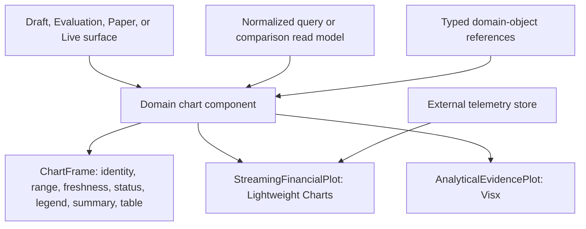

# Charting Architecture

## Status

Accepted for frontend implementation.

## Outcome

Vantheon uses two chart engines behind separate semantic boundaries:

- **Lightweight Charts** for streaming financial time series that need efficient incremental updates and familiar financial interaction.
- **Visx** for bespoke analytical and explanatory visualizations where Vantheon's evidence model, annotations, and domain-object correlation matter more than tick throughput.

This is a deliberate specialization, not a fallback chain. Feature code does not choose an engine ad hoc, and the engines are never hidden behind one lowest-common-denominator chart API.

## Engine Selection

| Chart family | Engine | Examples | Update model |
|---|---|---|---|
| Live financial time series | Lightweight Charts | Price, candlesticks, volume, portfolio equity, benchmark overlay | Imperative incremental updates from the external telemetry store, conflated to animation frames |
| Historical financial time series with financial navigation | Lightweight Charts | Paper or Live performance history, price history around a decision | Snapshot seed plus imperative append or bounded replacement |
| Analytical evidence | Visx | Drawdown, attribution, allocation, exposure, distribution, regime, and risk views | Declarative React rendering from query-backed or bounded derived data |
| Strategy and evidence comparison | Visx | Version deltas, common-window Paper comparison, risk/return tradeoffs | Declarative rendering from immutable comparison read models |
| Run and decision explanation | Visx where a plot is useful; semantic HTML otherwise | Rule annotations, screened-universe funnels, decision markers, no-trade evidence | Event-linked bounded data; never a raw tick feed |
| Genuinely tabular evidence | Semantic table, not a chart engine | Positions, orders, rule evaluations, exact sampled values | TanStack Table or semantic HTML with virtualization where needed |

Do not use shadcn's general chart component or add a third general-purpose chart library for these families. A new family must be classified here before choosing an implementation.

## Shared Product Boundary

Every material chart is assembled through a shared product frame and one engine-specific plot.



`ChartFrame` owns shared presentation and comprehension behavior:

- Chart title, metric, entity, currency or unit, and selected range.
- Loading, empty, stale, delayed, estimated, disconnected, and failed states.
- Freshness and data-cutoff presentation.
- Legend and series controls that do not depend on color alone.
- Same-source textual summary and accessible table or structured download.
- Keyboard-accessible inspection and focus management.

It does not own financial state, fetch data, subscribe to streams, calculate business eligibility, or normalize engine-specific coordinates.

Engine-specific plots remain separate because their lifecycle and performance models differ:

- `StreamingFinancialPlot` owns a Lightweight Charts instance, series lifecycle, resize behavior, and imperative draw calls.
- `AnalyticalEvidencePlot` owns Visx scales, shapes, axes, interactions, and SVG presentation for bounded analytical data.

Domain components such as `PortfolioEquityChart`, `DrawdownEvidenceChart`, `AllocationAttributionChart`, and `PaperComparisonChart` select the correct plot and expose product semantics. Screens do not import either engine directly.

## Suggested Directory Boundary

```text
src/
├── components/
│   └── domain/
│       └── charts/
│           ├── chart-frame.tsx
│           ├── portfolio-equity-chart.tsx
│           ├── drawdown-evidence-chart.tsx
│           ├── allocation-attribution-chart.tsx
│           └── paper-comparison-chart.tsx
└── lib/
    └── charts/
        ├── contracts.ts
        ├── normalization.ts
        ├── accessible-summary.ts
        ├── lightweight/
        │   ├── streaming-financial-plot.tsx
        │   └── series-controller.ts
        └── visx/
            ├── analytical-evidence-plot.tsx
            └── interaction-model.ts
```

Do not create a barrel imported by the persistent application shell that re-exports both engines. Shared contracts and normalization code must not import either rendering package.

## Data and Authority Contract

- Charts render normalized read models; they never define business truth.
- The visual plot, textual summary, table, and download use the same normalized source, range, unit, timezone, and data cutoff.
- Derived metrics with financial meaning are calculated in reviewed domain selectors or server read models, not inside tooltip renderers.
- Every point or aggregate that opens a run, decision, order, strategy, or message uses a typed domain reference.
- Model-generated prose may explain a chart but cannot supply its authoritative values, freshness, eligibility, or comparison validity.
- Missing, estimated, stale, and delayed observations remain distinguishable from confirmed zero values.

## Update and Lifecycle Rules

### Lightweight Charts

- Seed a bounded series from the current snapshot or cached history.
- Apply high-frequency updates through the external subscription store and an imperative controller.
- Conflate visible updates to animation frames while preserving logical event order for correctness and audit surfaces.
- Do not put each tick into React state or rebuild the chart instance because a parent surface rerenders.
- Explicitly create, resize, detach subscriptions from, and dispose each chart instance.
- Warm-navigation caches may retain normalized chart state; they do not prove freshness or authorization.

### Visx

- Render query-backed snapshots, immutable comparisons, or deliberately bounded derived series.
- Memoize expensive scales, paths, bins, and layout calculations by normalized input identity.
- Do not map an unconstrained market-event stream into one SVG element per event.
- Aggregate or sample dense analytical data according to a disclosed policy that preserves material conclusions and the accessible equivalent.
- Keep pointer and keyboard selection in local interaction state; selected domain objects remain identified by stable references.

If a proposed Visx chart needs live tick-rate rendering or thousands of independently updating marks, stop and benchmark the actual surface before implementation. Do not silently turn Visx into a second live-chart engine.

## Loading and Bundle Boundary

Both engines are accepted dependencies, but neither belongs in the persistent shell bundle.

- Put Lightweight Charts and Visx in separate client leaf modules.
- Dynamically load the engine chunk when a chart family first becomes relevant.
- Prefetch the expected chunk when navigation intent is strong, such as selecting a Paper portfolio or opening comparison.
- Install only the Visx packages a shipped chart uses; do not install or import an umbrella package for convenience.
- Avoid a shared runtime registry that statically imports both engines.
- Record route and shared-chunk sizes in production builds and review regressions alongside representative browser timing.

An isolated measurement on 2026-07-14 used esbuild-minified ESM, React externalized, Lightweight Charts 5.2.0, and Visx 4.0.0. A representative Lightweight Charts import was approximately 171.8 KB raw and 55.6 KB gzip. Selected Visx shape, scale, axis, group, responsive, and tooltip imports were approximately 85.4 KB raw and 29.8 KB gzip. The combined measurement was approximately 257.4 KB raw and 85.1 KB gzip.

These values explain the decision; they are not application budgets. Next.js chunking, application code, compression, imports, and future library versions will change the delivered size. Numeric gates follow representative production-build baselines under D-018.

## Accessibility Contract

SVG does not make a Visx chart automatically accessible, and canvas does not exempt a Lightweight Charts surface from equivalent access.

Every material chart must satisfy `docs/accessibility-and-motion.md`, including:

- A meaningful accessible name and concise same-source summary.
- A keyboard-operable path to the same material inspection and comparison tasks.
- Focus-reachable information that would otherwise exist only in a tooltip or crosshair.
- A meaningful table or structured equivalent for non-text information.
- Explicit missing, stale, delayed, and estimated-data treatment.
- No conclusion communicated through color or motion alone.

## Validation Contract

- Unit-test normalization, derived metrics, domain-reference resolution, and visual/summary/table equivalence.
- Exercise representative Lightweight Charts and Visx surfaces with deterministic fixtures in Playwright.
- Measure engine-chunk loading, chart-ready time, draw-to-next-frame timing, input responsiveness, memory, and cleanup.
- Run streaming scenarios while analytical charts, conversation, navigation, and tables are active to detect broad React rerenders.
- Verify final visible values and configured history windows against the simulator oracle.
- Test narrow/wide layouts, resize, range changes, keyboard inspection, reduced motion, stale data, empty data, and reconnect.

## Revisit Triggers

Revisit the two-engine decision only when production-build evidence shows unacceptable route cost, a required chart family cannot satisfy its interaction or accessibility contract, or measured rendering behavior violates the accepted responsiveness baseline. A revisit compares actual representative surfaces; it does not replace one engine based on package count alone.
