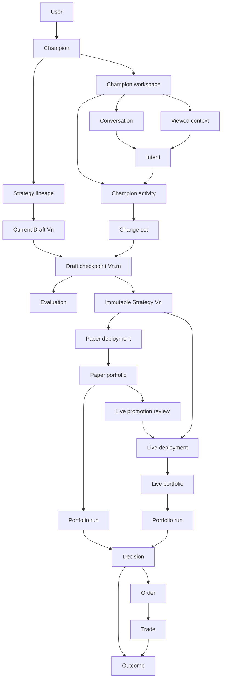

# Frontend Domain Model

## Status

Accepted as the canonical frontend-facing conceptual model for the demo and initial architecture.

This document defines the identity, relationships, invariants, and provenance that product surfaces must preserve. It is not a database schema, API specification, event payload definition, or backend orchestration design. Implementations may combine or split records as long as every concept and invariant below remains observable through the frontend contracts.

## Model at a Glance



The diagram is intentionally conceptual. It does not prescribe whether a relationship is embedded, joined, streamed, or materialized by a backend.

## Entity Distinctions

The canonical product glossary lives in [Product Foundations](./product-foundations.md#canonical-terminology). This table adds domain distinctions needed for implementation; it does not redefine the product terms.

| Term | Meaning | Not the same as |
|---|---|---|
| Champion | The persistent AI agent identity with which a user collaborates | Workspace, chat thread, strategy, or model instance |
| Champion workspace | The product shell that brings one Champion's Draft, Paper, Live, conversation, and activity together | Champion identity |
| Strategy lineage | One Champion's current Draft generation, its restorable checkpoints, and immutable strategies created from prior Drafts | A single Draft or portfolio |
| Draft | The only mutable strategy candidate in the MVP, displayed as `Drafting Vn` | An immutable deployed strategy |
| Draft checkpoint | A restorable, authoritative state inside the current Draft generation, displayed as `Checkpoint m`; canonical records may use `Vn.m` | A low-level autosave or every command |
| Immutable strategy | The frozen strategy snapshot produced from an exact Draft checkpoint and identified by its major generation, such as `Strategy V5` | Draft V5 at checkpoint V5.2 while it is still evolving |
| Paper portfolio | A persistent simulated portfolio that gathers evidence while controlled by an immutable strategy | An evaluation, run, or strategy |
| Live portfolio | A persistent capital-bearing portfolio controlled through an explicit Live deployment | A Paper portfolio or strategy |
| Deployment | The auditable assignment of one immutable strategy to one portfolio for a defined period | The portfolio itself |
| Portfolio run | One scheduled decision and execution cycle within a portfolio | The portfolio, a bounded user-requested Evaluation, or a strategy version |
| Evaluation | A bounded dry run, quick evaluation, or backtest against disclosed assumptions | A scheduled portfolio run |

Normal product UI reserves `Vn` for strategy generations. It displays active work as `Drafting Vn`, its saved state as `Checkpoint m`, Paper by stable portfolio name with `Running Strategy Vn`, and Live as `Live · Running Strategy Vn`. Canonical records may retain compound checkpoint identity `Vn.m`, but normal UI does not repeat the generation inside the checkpoint label. Detail surfaces expose portfolio identity, controlling immutable strategy, exact source checkpoint, and operational state.

## Version and Checkpoint Semantics

### Major generation

`Drafting Vn` names the current mutable candidate for the next immutable strategy generation. The MVP has exactly one active Draft generation per Champion.

### Minor checkpoint

Canonical identity `Vn.m` identifies a restorable state within Drafting Vn. Normal UI displays only `Checkpoint m` because the active Draft already supplies `Vn`.

- The active Draft is the latest authoritative checkpoint, whether or not that checkpoint has been tested.
- A completed Evaluation attaches evidence to its exact checkpoint; it never changes which checkpoint is active.
- `V5.0` is the initial checkpoint of Draft V5.
- A generation-initialization checkpoint `Vn.0` clones the exact structured strategy frozen from the prior launched checkpoint. It records lineage but is not produced by a semantic change set.
- One accepted semantic Draft change set produces one next checkpoint, such as `V5.1 → V5.2`, regardless of its authorized initiator.
- A change set may contain several related domain commands; those commands still produce one checkpoint when accepted together.
- Explanation, research, questions, and other non-mutating conversation do not increment the checkpoint.
- Proposed, rejected, failed, cancelled, or superseded changes do not increment the checkpoint.
- Background autosaves and local recovery snapshots do not create product-facing checkpoints.

### Paper launch

Launching Draft V5 from checkpoint V5.2 to Paper has three authoritative results:

1. Freeze exact checkpoint V5.2 as immutable Strategy V5.
2. Start a named Paper portfolio using that immutable strategy and display `Running Strategy V5`.
3. Begin Drafting V6 at Checkpoint 0 for future work.

Draft V6 checkpoint V6.0 contains the same structured strategy content as Draft V5 checkpoint V5.2 and immutable Strategy V5. The new generation exists to separate future development from Paper V5; it does not imply that strategy behavior has already changed. The first accepted semantic change creates checkpoint V6.1.

The transition must not expose a state in which Paper V5 appears active while Draft V5 remains the mutation target. If provisioning fails, no active Paper is presented and Draft V5 at checkpoint V5.2 remains unchanged. A prepared immutable candidate may be retained for safe retry, but it does not advance the Draft generation by itself.

### Deployed labels and provenance

The major number communicates the strategy generation controlling a portfolio. The source checkpoint communicates the precise working state that was frozen.

```text
Growth Test
Running Strategy V5
Strategy snapshot from Drafting V5 · Checkpoint 2
```

Named Paper portfolios running Strategy V5, V6, and V7 may all coexist. Promoting one Paper strategy to Live does not delete or mutate any Paper portfolio.

## Canonical Concepts

### User and authorization context

Represents the human actor and their current authority to view or act. Identity, authentication, and authorization are separate concerns: a cached user identity or subscribed stream never proves current authorization.

Frontend contract must make available:

- Current actor identity.
- Current access state and relevant capabilities.
- Session expiry or revoked-access state.
- Safe behavior for cached projections when authorization changes.

### Champion

The durable collaborator identity that develops strategies and explains outcomes.

Frontend contract must make available:

- Stable identity and display identity.
- Current availability or activity summary.
- Link to one workspace and one active strategy lineage in the MVP.
- Provenance identity for Champion-authored messages and proposed changes.

A Champion may be implemented using changing models, tools, or runtime configurations. Those runtime details do not replace the stable Champion identity and must be captured separately when required for reproducibility.

All Champion inputs are untrusted data and all Champion outputs are proposals. The runtime does not own Draft, Paper, Live, order, or authorization state. Independent validation, scoped tools, human gates, runtime provenance, and model-regression requirements are defined in [Champion Runtime Safety](./champion-runtime-safety.md).

### Champion workspace

The persistent UI context around a Champion. It coordinates navigation and presentation; it does not own authoritative strategy or financial state.

Its minimum semantic context is:

- Viewed surface: Draft, a specific Paper portfolio, a specific Live portfolio, a run, or an evaluation.
- Mutation target: always the current Draft checkpoint for strategy-changing actions.
- Persistent conversation context.
- Current Champion activity and connection freshness.

The UI must preserve viewed context and mutation target independently. Selected context appears as a composer attachment; the Draft target appears when Atlas interprets a strategy-changing request and again in the semantic proposal, for example:

```text
Selected: Paper V5 · Run 42
Proposed change: Draft V8 · checkpoint V8.4
```

### Strategy lineage

The ordered conceptual history connecting Draft generations, their checkpoints, and immutable strategies. The MVP permits one active Draft lineage and no alternative active Draft branches.

The lineage preserves:

- Generation and checkpoint order.
- Which checkpoint produced each immutable strategy.
- Which accepted change sets produced each checkpoint.
- Which evaluations and portfolios used each strategy state.

### Draft generation

The mutable canonical strategy candidate for one major generation.

Frontend contract must make available:

- Generation identity, such as Draft V8.
- Current authoritative checkpoint, such as V8.4.
- Structured strategy projection.
- Validation, synchronization, and recovery state.
- Unresolved assumptions or conflicts.

The server owns the authoritative Draft. Zustand may hold a projection and IndexedDB may preserve pending commands and recovery material; neither is the source of truth.

### Draft checkpoint

A restorable, authoritative strategy state created after one accepted semantic Draft change set, regardless of whether it originated from conversation, direct editing, autonomous Champion work, or another authorized actor.

Each checkpoint must retain conceptual references to:

- Its Draft generation and previous checkpoint.
- The accepted change set that produced it.
- The resulting structured strategy state.
- Actor and time provenance.
- Reproducibility context needed to interpret or replay it.

Checkpoints are restorable history, but restoring one still happens through a validated semantic change against the current Draft. Restoring V8.2 while current checkpoint V8.4 creates a restore proposal against V8.4; acceptance produces V8.5 with V8.2's strategy content under the current schema. It does not move the checkpoint pointer backward, rewrite deployed strategies, or erase V8.3/V8.4 provenance. Incompatible schema or protected-constraint changes enter conflict resolution.

### Immutable strategy

The exact deployable strategy frozen from one Draft checkpoint.

Frontend contract must make available:

- Major generation identity.
- Exact source Draft checkpoint.
- Read-only structured strategy.
- Semantic changes and originating provenance.
- Relevant schema, Champion runtime, toolset, model configuration, and market-data cutoff references when reproducibility requires them.

An immutable strategy is never edited in place. A desired change becomes a proposal against the current Draft.

### Conversation and message

Conversation is the persistent human–Champion interaction history. A message is append-only evidence of what an actor said, proposed, explained, or requested; it is not canonical strategy state.

A message may:

- Express ambiguous intent.
- Cite a portfolio, run, decision, rule, evaluation, or checkpoint.
- Motivate a change set.
- Carry streamed presentation parts or progress.
- Explain why no mutation occurred.

Conversation must never be replayed as the sole method of reconstructing a strategy, discovering current work, or determining whether work completed. Messages carry typed references to the affected intent, activity, change set, checkpoint, Evaluation, run, Decision, Live eligibility assessment, or deployment where applicable. Those objects remain independently addressable and inspectable.

The causal bridge is `message or direct action → interpreted intent → activity and proposed work → authoritative domain result`. A message may summarize that bridge, but it does not replace it.

### Champion activity

A structured projection of work the Champion runtime or surrounding system is performing, such as interpreting intent, researching, preparing a change set, waiting on an Evaluation, validating, or requiring user input.

Activity retains:

- Stable work identity and lifecycle state.
- Originating message or direct domain action when applicable.
- Viewed context and affected domain-object references.
- Verified phase and timestamps emitted by the responsible server process.
- Result, failure, cancellation, or required-user-action reference.

Activity is not freeform chain-of-thought and does not expose hidden model reasoning. It reports coarse, verifiable work phases. Model-generated status text may explain a phase but cannot advance it. Completed work must resolve to an independently inspectable domain result rather than ending only in a message.

### Intent

A human- or Champion-originated goal that may require investigation and several operations, such as “reduce drawdown without sacrificing most historical return.” Intent is not necessarily an immediate state mutation.

Intent retains:

- Originating actor and message or system event.
- Viewed evidence context.
- Current Draft mutation target.
- Material assumptions and requested outcome.

### Change set

A reviewable semantic proposal that groups related typed commands into one understandable strategy change.

Frontend contract must make available:

- Base Draft checkpoint.
- Proposed semantic changes.
- Motivation and evidence references.
- Expected benefit, downside, unchanged constraints, and required follow-up evidence.
- Lifecycle state: proposed, submitted, validating, accepted, rejected, failed, conflicted, cancelled, or superseded.
- Accepted checkpoint reference when applied.

The change set is the product-level unit of review and checkpoint creation. It is not just a raw JSON diff.

### Command

A typed domain operation submitted through a validated server boundary. Every authoritative writer—human, Champion, risk engine, or collaborator—uses this pattern, but the target domain determines its preconditions and outcome.

Every command conceptually identifies:

- Operation and semantic parameters.
- Actor and target entity.
- Entity-appropriate concurrency and authorization preconditions.
- Validation and application outcome.
- Idempotency identity for safe retry.

Draft mutation commands additionally identify their base checkpoint and semantic change-set membership. Paper-launch, Live-promotion, order, and operational commands use portfolio-, deployment-, order-, or authorization-specific preconditions and do not create Draft checkpoints.

Draft commands explain how a change was attempted. Comparing final checkpoints establishes what ultimately changed. Visible semantic diffs may use both and must collapse noise, reversals, migrations, and equivalent command sequences into domain language. Consequential non-Draft commands remain separately auditable and are never silently replayed from an offline queue.

### Evaluation

A bounded test of a Draft checkpoint or immutable strategy under disclosed conditions. Evaluation types may include quick evaluation, dry run, and backtest.

Frontend contract must make available:

- Tested strategy reference.
- Evaluation type and lifecycle state.
- Universe, benchmark, time window, simulated capital, transaction assumptions, market-data cutoff, and known limitations.
- Decisions, actions, rejections, risk behavior, and comparative evidence.
- Infrastructure failure separately from strategy performance or inconclusive evidence.

An evaluation may share execution infrastructure with portfolio runs, but it is not part of a persistent portfolio's scheduled history.

### Live eligibility assessment

A server-authoritative, versioned policy result that determines whether a specific Paper-tested strategy may enter Live promotion review. Paper has no eligibility assessment; its launch command receives ordinary structural, authorization, destination, and concurrency validation.

Frontend contract must make available:

- Policy identity and version.
- Exact immutable Paper strategy assessed.
- Every satisfied, missing, failed, stale, and warning criterion.
- Assessment time and data cutoff.
- Whether the result blocks progression or is advisory.
- Required remediation or additional evidence.

Live eligibility applies the approved evidence thresholds, operational/data/risk health, authorization, and freshness required by D-027. It never substitutes for explicit human confirmation. Paper launch review may display Dry Run evidence and setup facts, but it never converts them into an `eligible` verdict.

### Portfolio

A persistent container of simulated or real capital, positions, orders, trades, performance, and run history.

Common frontend contract:

- Stable portfolio identity and mode: Paper or Live.
- Display label and controlling immutable strategy.
- Exact source checkpoint through the strategy reference.
- Current deployment period.
- Operational state and freshness.
- Capital, positions, orders, performance, risk, and schedule summaries.
- Independent run history.

Portfolio history survives strategy deployment changes. A portfolio never becomes a run, and a Draft never becomes a portfolio.

### Paper portfolio

A simulated portfolio used to accumulate evidence and compare strategy generations without real capital.

MVP behavior:

- Launching Draft V5 creates a new Paper V5 portfolio controlled by immutable Strategy V5.
- Existing Paper portfolios remain active or retained independently.
- New strategy work targets the current Draft, not Paper V5.
- Comparing Paper portfolios discloses unequal observation windows, schedules, assumptions, and run counts.
- Every comparison declares a validity envelope. If P-008 thresholds are unmet, the comparison remains descriptive and is labelled `Insufficient comparable evidence`; it cannot rank or recommend a winner.
- Users may stop future runs without deleting evidence. A run already executing may reach a terminal state, during which the portfolio is `stopping`; no later scheduled run begins.
- Only a stopped Paper portfolio may be archived. Archived Paper remains searchable, inspectable, and available as historical comparison context but does not run or retain full-resolution subscriptions.
- Unarchiving returns Paper to `stopped`; it never resumes schedules or changes the pinned immutable strategy automatically.

The frontend should not imply that Paper evidence guarantees Live performance.

### Live portfolio

A capital-bearing portfolio whose controlling strategy must have passed the explicit Paper-to-Live review path.

Frontend contract adds:

- Capital-at-risk visibility.
- Active strategy and deployment period.
- Risk, exposure, pending actions, and authorization state.
- Separate audited controls for pausing future Champion executions and cancelling eligible open orders.

The current IA exposes one Live destination per Champion, but the conceptual model does not encode that as a permanent backend limitation.

### Deployment

An auditable, time-bounded relationship that assigns one immutable strategy to one portfolio.

It retains:

- Portfolio and immutable strategy references.
- Mode, start, end, and operational status.
- Promotion evidence and confirmation references.
- Actor and authorization provenance.
- The deployment it superseded, when applicable.

At most one deployment controls a portfolio at a time. Updating a Live portfolio closes the prior deployment period and begins another; it never rewrites earlier runs or trades. For the MVP, a Paper portfolio remains pinned to its initial strategy and a newer Draft launches a separate Paper portfolio, but the deployment concept keeps provenance correct without forcing the UI to expose another navigation level.

### Portfolio run

One scheduled decision and execution cycle inside a portfolio under its active deployment. User-requested bounded tests remain Evaluations rather than portfolio runs in the MVP.

Frontend contract must make available:

- Portfolio, deployment, immutable strategy, and schedule references.
- Start, completion, data cutoff, and freshness information.
- Evaluated universe and rule evaluations.
- Decisions, rejections, orders proposed or submitted, and failures.
- Result classification: no trade, orders submitted or pending, trade observed during the run, failed, or cancelled.

Runs are immutable evidence once complete. `Run 2 · Strategy V5` is preferred to `V5.2 Paper Run`, which could be confused with Draft checkpoint V5.2.

### Rule evaluation

Evidence that a strategy condition passed, failed, could not be evaluated, or was not reached during a run or evaluation. It links the observed behavior to the exact immutable rule or Draft checkpoint being tested.

### Decision

The Champion or strategy conclusion produced within a run or evaluation, including actions and explicit inactivity.

Decision types include:

- Propose or create an order.
- Hold or make no change.
- Reject an opportunity.
- Reduce, pause, or otherwise constrain activity according to policy.

Every decision retains its rule evaluations, input data cutoff, strategy reference, and explanation. No-trade decisions are first-class evidence rather than missing activity.

### Order

An instruction to transact, with a lifecycle distinct from the decision that proposed it. A decision may produce no order, one order, or several orders. An order may be rejected, cancelled, partially filled, filled, or expired.

Presentation must distinguish proposed, pending, accepted, and terminal order state. Client animation or optimistic state must not imply broker or server acceptance.

### Trade

An executed fill or economically meaningful execution event resulting from an order. Trades are immutable financial facts. Strategy or configuration changes may be reversed through new commands; an executed trade cannot be undone by editing history.

### Outcome

An observable consequence or evidence item attributable to a portfolio, run, decision, order, or trade. Examples include inactivity, position change, realized or unrealized performance, exposure, drawdown, risk status, or a failure to act.

An outcome is useful only when the frontend can trace it backward to the run and exact immutable strategy responsible. Market movement may contribute to an outcome without being caused by a Champion decision; attribution must preserve that distinction.

## Provenance Contract

The complete causal chain is:

```text
Message or system observation
→ interpreted intent
→ semantic change set
→ typed commands
→ Draft checkpoint
→ immutable strategy
→ deployment
→ portfolio
→ portfolio run
→ rule evaluations and decision
→ order
→ trade or no-trade outcome
→ portfolio outcome
```

Not every chain contains every node. A no-trade decision has no order or trade. A failed change set has no checkpoint. An evaluation references a checkpoint or immutable strategy without requiring a deployment or portfolio.

Every user-visible explanation must distinguish:

- **Causation:** the decision or trade directly changed the portfolio.
- **Attribution:** market movement changed value while a strategy held exposure.
- **Context:** a message, observation, or test motivated a later change.
- **Correlation:** evidence appeared together but no causal claim is supported.

## Simulator and Timing References

Performance metadata is a measurement contract, not product-domain authority.

### Simulator scenario descriptor

Identifies a reproducible workload through:

- Scenario name and deterministic seed.
- Clock mode and start time.
- Active Champions, portfolio cache tiers, instruments, history sizes, and event rates.
- Burst, message-size, chat-token, command-delay, jitter, disconnect, error, duplicate, stale, and logical reordering controls.
- Synthetic or sanitized dataset identity.

### Stream event envelope

Each simulated or production-like event needs enough identity and timing to measure and reconcile it:

- Stable event identity for deduplication.
- Stream identity, epoch, and logical sequence for ordering.
- Domain entity reference and authoritative revision when applicable.
- Server emission time.
- Browser receipt, store application, subscriber notification, and next-paint marks recorded by the client.

Logical sequence and authoritative revision determine ordering. Wall-clock timestamps are for measurement and display, not conflict resolution.

### Command timing

Command measurements distinguish:

```text
client submission
→ server acknowledgement
→ authoritative acceptance or rejection
→ patch received
→ local projection applied
→ authoritative result visibly painted
```

The performance report derives event-to-paint and command-to-visible-confirmation distributions from these references. It must also report stale age, duplicates discarded, gaps recovered, conflated visual updates, queue depth, long tasks, responsiveness, and memory behavior.

## Authority and Frontend Ownership

Each state domain has one authoritative owner. “Client owner” below means responsibility for projection or interaction, not business authority.

| State domain | Authoritative owner | Frontend projection or interaction owner | Persistence expectation |
|---|---|---|---|
| Champion identity and access | Server | TanStack Query plus session boundary | Revalidate with authorization |
| Draft, checkpoints, Draft change sets, and Draft mutation commands | Server strategy domain | TanStack read model and mutation state; Zustand interaction projection | Server canonical; IndexedDB recovery for eligible Draft commands only |
| Immutable strategies | Server strategy domain | TanStack Query | Entity immutable; indexes may evolve |
| Conversation and messages | Server | Streaming chat projection and TanStack history | Append-only evidence |
| Champion activity | Server orchestration/activity domain | TanStack read model plus ordered activity feed | Durable summary and result references; model prose cannot advance lifecycle |
| Evaluations | Server execution service | TanStack Query and streamed progress | Immutable after terminal result |
| Live eligibility assessments | Server policy and risk domain | TanStack Query plus Live review UI | Versioned result; recompute when inputs become stale |
| Portfolios, deployments, Paper launches, Live promotions, and operational controls | Server portfolio and deployment domain | TanStack Query read models and mutation state | Durable financial or simulated evidence; consequential commands are not queued offline |
| Runs, decisions, orders, and trades | Server execution domain, which reconciles venue or broker events | TanStack Query plus pushed reconciliation | Durable; append or transition by authority |
| High-frequency market telemetry | Market or server stream | External subscription store and chart bindings | Ephemeral plus bounded history |
| Panel, selection, focus, and compare state | Browser | Zustand or local React state | Disposable unless UX requires restoration |
| Pending recoverable Draft commands | Browser until submitted; server strategy domain after acceptance | Dexie and recovery coordinator | Recovery buffer, never Draft authority; excludes Paper, Live, order, and operational commands |
| Simulator scenario and synthetic clock | Test harness | Test controls and performance collector | Persist seed and report artifacts |

## Non-Negotiable Invariants

1. Each Champion has exactly one active Draft lineage in the MVP.
2. Only the current Draft accepts strategy mutations.
3. Each accepted semantic Draft change set creates one new checkpoint; non-mutating, rejected, or autosave-only work does not. A `Vn.0` checkpoint is the explicit generation-initialization exception.
4. Every command is safe to retry by identity and validates entity-appropriate preconditions; Draft mutations additionally validate an explicit base checkpoint.
5. A local projection, streamed tool call, cached entity, or IndexedDB snapshot never becomes authoritative by presentation alone.
6. An immutable strategy never changes after creation.
7. Paper and Live always identify the immutable strategy and exact source checkpoint controlling them.
8. Draft changes never alter an existing Paper or Live strategy.
9. Multiple Paper portfolios may coexist and retain independent evidence histories.
10. A portfolio is persistent and contains runs; a portfolio is never a run.
11. Every run pins the deployment and immutable strategy active when it began.
12. Completed runs, decisions, orders, trades, and outcomes retain historical provenance even after a later deployment.
13. Live promotion follows eligible Paper evidence, explicit impact and risk review, current authorization, and human confirmation.
14. Pausing future Live executions and cancelling eligible open orders are distinct audited operations.
15. Failed promotion leaves the previous active deployment and current Draft understandable and unchanged.
16. Old Paper or Live evidence becomes a proposal against the latest Draft; it never silently overwrites the Draft or creates an MVP branch.
17. No-trade and rejected decisions are first-class outcomes.
18. Sequence and revision establish event order; timestamps measure latency and freshness.
19. Reconnect reconciliation is idempotent and must converge to the same authoritative state as uninterrupted replay.
20. Every portfolio outcome can be traced to a run and exact immutable strategy, while market attribution remains distinct from Champion causation.
21. A new generation's `Vn.0` content matches the exact checkpoint frozen for the preceding Paper launch unless the user performs a separate explicit start-from action.
22. Restoring an older checkpoint creates a new reviewed checkpoint and never rewinds or deletes history.
23. Paper launch uses server command validation and explicit confirmation without an eligibility state; Live progression uses a versioned server eligibility assessment and missing hard criteria fail closed.
24. Champion input is untrusted and Champion output is non-authoritative until independent validation and required human gates complete.
25. Stopping or archiving Paper preserves its immutable strategy, runs, decisions, and comparison provenance; archiving requires Stopped state, and unarchiving never resumes runs automatically.

## Deliberately Out of Scope

This document does not decide:

- Database tables, columns, indexes, or event-store implementation.
- REST, RPC, WebSocket, or streaming endpoint shapes.
- Backend service boundaries or orchestration engine internals.
- Brokerage integration details, settlement, tax lots, or jurisdiction-specific rules.
- Model prompts, tool implementation, or model-provider selection.
- Multi-user merge algorithms or alternative Draft branching.
- Permanent cardinality limits for strategies, portfolios, accounts, or Live destinations.

Those designs must conform to this conceptual contract rather than being inferred from UI labels.
