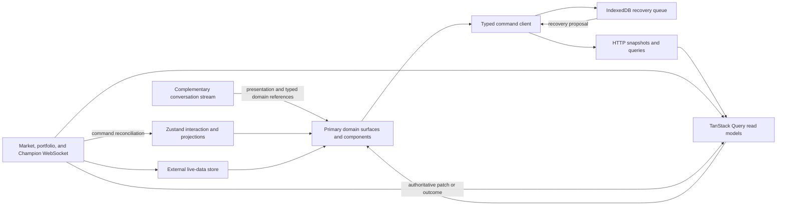
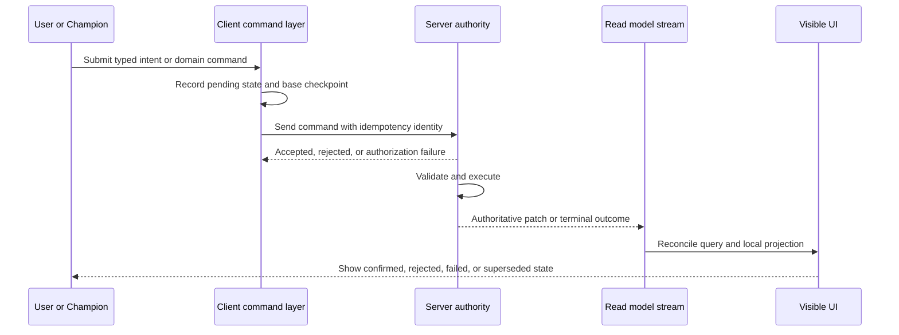

# Frontend Architecture

## Status

Accepted as the implementation baseline for the demo. Open choices are tracked as Proposed Decisions in `docs/decisions.md`; each proposal names the point at which dependent implementation must stop.

## Purpose

The frontend must make the two priority journeys fast and trustworthy:

1. Intent to understandable evidence to Paper.
2. Observed behavior to a tested Draft improvement.

The architecture therefore optimizes for a persistent Champion workspace, explicit authority boundaries, deterministic recovery, and responsive live surfaces. It describes frontend-facing responsibilities and contracts. Exact API payloads, database fields, matching/execution design, and backend orchestration are out of scope.

## Governing Rules

> Reads arrive as snapshots, queries, and ordered patches. Writes leave the client as typed commands. Only an authoritative server patch changes business truth.

- The structured strategy is canonical; conversation is intent and provenance.
- Domain surfaces and correlated activity remain complete without the conversation panel; chat never owns work status or result state.
- Draft is mutable and revisioned. Paper and Live strategies are immutable.
- Zustand helps render reality; it does not define financial or strategy reality.
- A streamed model response, successful HTTP status, or optimistic animation is not proof that a command was applied.
- High-frequency telemetry is isolated from ordinary React rendering.
- No client cache, connection, or subscription proves current authorization.
- Failure must leave the user able to distinguish last-known data, pending work, and confirmed state.

## Accepted Stack

| Concern | Choice | Boundary |
|---|---|---|
| Application | React, TypeScript, Next.js App Router | One application with persistent layouts until measurements justify a split |
| Server-backed reads | TanStack Query | Entities, indexes, history pages, snapshots, and feed read models |
| Local interaction | Zustand | Selection, panel state, compare state, composer state, and non-authoritative projections |
| Recovery | Dexie over IndexedDB | Pending Draft commands, base checkpoints, and recoverable local projections |
| Live telemetry | External subscription store | Market and portfolio values outside the general React render cycle |
| Chat | AI SDK UI data streams | Tokens, structured message parts, progress, and tool presentation |
| Live events | Persistent WebSocket | Market, portfolio, command-result, and Champion activity events |
| Chart engines | Lightweight Charts plus selective Visx behind separate domain adapters | Streaming financial series use imperative Lightweight Charts; bounded analytical evidence uses declarative Visx |
| Large collections | TanStack Table and virtualization | Runs, positions, orders, conversations, and comparison histories |
| UI primitives | Uncustomized shadcn/ui | Generic interaction only; product semantics live in domain components |
| Browser testing | Playwright | Critical journeys, accessibility, resilience, and event-to-paint measurement |
| Protocol pressure | k6 | Concurrent HTTP and WebSocket pressure without claiming browser-render coverage |

Web Workers, SharedWorker, binary encoding, custom WebGL, CRDTs, and a second frontend application are measured-load or collaboration optimizations, not demo prerequisites.

## Runtime Topology

Transport handlers and stores live above route-level surfaces. Switching Draft, Paper, Live, or Champion must not rebuild the transport layer.

## Correlated Workspace Projections

Conversation, Champion activity, and the active domain surface are separate projections of connected work.

- A stable correlation graph links message or direct action → intent → activity → command/change set or Evaluation → checkpoint/run/outcome.
- The conversation stream owns provisional tokens and message presentation only. It does not own whether research is running, a command applied, an Evaluation completed, or a portfolio changed.
- Champion activity and domain status arrive through server read models and ordered events, so they remain visible when conversation is collapsed, virtualized, disconnected, or loading history.
- Structured message parts contain typed domain references. A reference resolver opens or focuses the canonical Draft section, Evaluation, run, Decision, comparison, eligibility assessment, or deployment review.
- Domain actions such as `Explain`, `Ask Champion`, and `Improve in Draft` attach the selected object identity, immutable source, data cutoff, and viewed context to the composer.
- Full semantic diffs, results, charts, positions, orders, and approvals render in domain surfaces. Conversation may show a concise preview, status, and link, but does not maintain a second authoritative copy.
- Closing or unmounting the conversation subtree never cancels accepted server work. Cancellation uses an explicit domain command with its own status and permission.

Selection and highlight state may live locally, but the referenced object and its lifecycle remain server-owned. Tests must exercise the same work with conversation expanded, collapsed, reloaded, and temporarily unavailable.

## State Ownership

Every state domain has one owner. Other layers may hold derived or last-known projections but must not compete for authority.

| State | Owner | Client representation | Update rule |
|---|---|---|---|
| Draft, checkpoint, and Draft change set | Server strategy domain | Query read model plus optional Zustand editing projection | Validated Draft command followed by authoritative patch |
| Immutable strategy | Server strategy domain | Query entity by ID | Never mutated; replace only an invalid local projection |
| Eligibility assessment | Server policy and risk domain | Query entity plus Paper/Live review projection | Versioned assessment; refresh when inputs become stale |
| Portfolio, deployment, Paper launch, Live promotion, and operational controls | Server portfolio and deployment domain | Query entities/indexes, mutation state, and live projections | Entity-specific commands, snapshots, and ordered patches |
| Run, decision, order, and trade | Server execution domain, which reconciles venue or broker events | Query entities/indexes and live projections | Entity-specific commands, snapshots, and ordered patches |
| Conversation history | Server append-only record | Paginated query/index | Append confirmed messages; reconcile streamed provisional parts |
| Champion work and activity | Server orchestration/activity domain | Query read model plus ordered activity projection | Verified lifecycle events correlated with affected domain objects and results |
| Market and portfolio telemetry | Live event service | External store and bounded history buffers | Sequence-aware snapshot/delta reconciliation |
| Viewed context | Workspace router | Route-derived Champion, surface, portfolio, run, or Evaluation identity | Navigation updates the route; Zustand may project but never own it |
| Draft mutation target | Server strategy domain | Current-Draft query reference shown by the workspace | Always resolves independently from viewed context |
| Panel, filter, hover, and compare UI | Browser | Zustand or component state | Local and disposable |
| Pending offline Draft work | Browser recovery layer | IndexedDB command queue | Replay only after base-checkpoint validation |
| Current authorization | Identity/authorization service | Ephemeral session state | Revalidated on request, connect, reconnect, and authorization change |

Do not mirror an entire query cache into Zustand. Store only interaction state or a deliberately normalized projection needed for an in-progress experience.

## Query, Cache, and Feed Rules

### Immutable entities and evolving collections

- An immutable strategy or completed run fetched by ID can remain fresh indefinitely, subject to memory eviction and authorization scope.
- Lists are not immutable merely because their members are. Version lists, run indexes, conversations, and timelines append or change membership and must be invalidated or patched.
- In-progress runs and commands remain evolving entities until they reach a terminal state.
- Query keys include the owning user or workspace scope wherever cache isolation requires it.
- Pagination and virtualization do not weaken provenance: an item reopened by ID must resolve to the same immutable source.

### Snapshot and patch reconciliation

1. Fetch a versioned snapshot with a logical cursor or sequence boundary.
2. Buffer deltas that arrive while the snapshot is in flight.
3. Apply only deltas newer than the snapshot boundary.
4. Deduplicate by stable event identity and reject invalid ordering.
5. On a detected gap, mark the view stale and request backfill or a replacement snapshot.
6. Do not clear a usable last-known view while reconciliation is in progress.

The exact sequence/cursor shape is a backend contract to be specified later.

### High-frequency feeds

- Keep tick-level and rapidly changing telemetry out of TanStack Query and broad Zustand subscriptions.
- Use bounded per-instrument or per-portfolio buffers in an external store.
- Subscribe React cells only to the smallest value they display.
- Update chart series imperatively where practical.
- Conflate visual updates to animation frames; retain the logical event sequence needed for correctness and audit views.
- Display freshness and connection state independently of value direction.

### Chart rendering boundary

- Use Lightweight Charts for live or historical financial time series that need financial navigation and efficient incremental updates.
- Use Visx for bounded analytical and explanatory views such as drawdown, attribution, allocation, distribution, risk, run annotations, and strategy or Paper comparison.
- Keep both engines behind separate domain components and leaf chunks; shared chart contracts must not import either renderer.
- Do not route raw tick feeds through Visx or ordinary React state.
- Load only the engine required by the current surface and prefetch it from strong navigation intent.
- Give every material chart the same-source summary, table or structured equivalent, freshness, status, and keyboard behavior defined in `docs/charting-architecture.md` and `docs/accessibility-and-motion.md`.

## Command and Patch Flow

Supported client-visible lifecycle terms are `proposed`, `submitting`, `accepted`, `executing`, `applied`, `rejected`, `failed`, `cancelled`, and `superseded`. Not every command uses every state.

- A client-generated command identity prevents accidental duplicate submission.
- The base checkpoint or revision detects stale Draft work.
- Acknowledgement means the request was received, not that business state changed.
- Only the authoritative patch or terminal outcome advances the confirmed projection.
- Paper launches, Live promotions, pausing executions, and cancelling orders fail closed and are never queued for silent offline replay.
- Optimistic presentation may be used for low-risk Draft interaction, but it is visibly pending and must reconcile without masquerading as confirmation.

## Chat and Event Transports

Chat and live telemetry have different rate, lifecycle, and failure characteristics and remain separate.

### Streamed chat

- Use the AI SDK UI stream for incremental text, structured message parts, progress, and tool-result presentation.
- Keep conversation rendering in a contained React subtree and virtualize long history.
- Memoize or block-buffer Markdown so every token does not reparse a long transcript.
- Treat tool calls rendered in chat as proposals or progress until a server-authoritative domain event confirms their effect.
- Persist the confirmed conversation and provenance links on the server; do not reconstruct strategy state by replaying prose.

### WebSocket events

- Use a persistent authenticated WebSocket for market data, portfolio telemetry, command results, and Champion cognition/activity.
- Separate logical channels and backpressure policies even if one physical connection is used.
- Market bursts may be visually conflated. Command outcomes, risk changes, and provenance events must not be discarded.
- Reconnect through an authenticated snapshot/backfill boundary rather than assuming the previous subscription is current.

Correlation identifiers connect a message, intent, command/change set, checkpoint, evaluation, portfolio run, and outcome across transports. P-003 owns their event identity and sequencing contract; P-011 owns telemetry encoding, retention, and redaction.

## Persistent Workspace and Cache Tiers

The Next.js layout keeps Champion identity, workspace navigation, conversation, transport providers, and caches alive while the center surface changes.

| Tier | Contents | Goal |
|---|---|---|
| Active Champion | Visible Draft or portfolio, full relevant chart data, recent conversation, live runs and activity | Immediate interaction and full detail |
| Warm Champions | Approximately 3–5 recently visited workspaces, recent messages, chart state, current aggregates, and last-known activity | Fast return without retaining every raw event |
| Aggregate-only | Identity, status, current version, value/performance summary, last activity, and small chart series | Cheap switching preview and progressive cold load |

The warm count is a starting hypothesis, not a guarantee. Memory measurements determine the final policy.

- Prefetch likely destinations on explicit intent such as hover, focus, or visible recent items without subscribing every Champion at full resolution.
- Reuse chart adapters and seed them from cached series rather than rebuilding the full workspace where measurement supports it.
- Prioritize identity, state labels, last-known summary, and primary action on cold loads; stream deeper history progressively.
- Explicit unmount plus rehydration from query/external-store caches is the baseline warm-navigation mechanism. React `Activity` may preserve selected hidden UI state as a measured React 19.2 optimization, but hidden effects are cleaned up; subscription and chart lifecycles therefore remain explicit either way.
- Eviction must remove UI instances and subscriptions without deleting authoritative query data still required elsewhere.

## Offline and Interrupted-Work Recovery

IndexedDB is a recovery guarantee for Draft work, not a system of record.

Each recoverable item retains enough context to identify its command, Draft generation, base checkpoint, ordering, and local projection. Exact fields are out of scope.

Recovery flow:

1. Load the server Draft and current checkpoint.
2. Load locally pending Draft commands and their base checkpoint.
3. If the base remains compatible, offer or perform deterministic replay through the normal command endpoint.
4. If the Draft advanced incompatibly, preserve the local work and open the semantic conflict surface.
5. Apply only server-accepted results; retain rejected work as an inspectable recovery item until the user discards or resolves it.
6. Clear recovered entries only after authoritative confirmation.

Never resolve a conflict by uploading the final local JSON snapshot over the server Draft. Never queue Live-capital or portfolio-control actions for later automatic execution.

## Semantic Change and Conflict Surfaces

`StrategySemanticDiff` and the conflict-resolution feature are first-class domain surfaces, not generic JSON viewers.

Semantic change review combines final snapshots with the relevant command/change-set history to show:

- Related changes grouped into one understandable intent.
- Before and after domain values.
- Motivation and source evidence.
- Expected benefit, possible downside, and unchanged constraints.
- Validation status and evidence still required.
- Provenance links to messages, runs, and evaluations.

Conflict resolution compares the source observation with the current Draft. It can apply, adapt, skip, or request clarification only through server-validatable choices. It must not silently branch the single active MVP Draft, replay an obsolete rule, or reduce the conflict to a raw JSON merge.

Checkpoint restore uses the same surface and command boundary. Selecting an older checkpoint creates a semantic proposal against the current checkpoint; acceptance creates the next checkpoint with restored content. The router, Query cache, and recovery layer never move an authoritative pointer backward locally.

## Champion Runtime Boundary

- Treat user content, retrieved research/news, tool results, and model-generated context as untrusted data.
- Treat streamed explanations, citations, semantic descriptions, and tool calls as proposals rather than validation.
- Derive before/after change facts from authoritative snapshots and validated commands, not solely from model prose.
- Scope and audit tools by read, Draft proposal, Evaluation, Paper review, Live review, and portfolio-control capability.
- Record model, policy, toolset, schema, input cutoff, command, and validation provenance for material proposals.
- Measure model/tool latency and token cost separately from browser event-to-paint performance.

The complete contract and upgrade-evaluation requirements live in [Champion Runtime Safety](./champion-runtime-safety.md).

## Authentication, Authorization, and Privacy

- Authenticate HTTP, chat streams, and WebSocket connections through a consistent session boundary.
- Re-authenticate every reconnect and handle mid-session expiry or revoked permissions.
- Treat authorization as resource- and action-specific; rendering a cached entity does not authorize a command.
- On logout or authorization loss, stop protected streams, cancel protected requests, clear or quarantine auth-scoped in-memory projections, and label any retained recovery data as unavailable until access is re-established.
- Coordinate logout and session changes across tabs.
- Do not store reusable bearer credentials in localStorage.
- Prevent secrets, raw brokerage credentials, customer conversation contents, strategy bodies, and account values from entering telemetry by default.
- Redact or hash identifiers used for correlation when raw identity is unnecessary.
- Use synthetic or explicitly sanitized data in fixtures, screenshots, performance artifacts, and CI.

The identity provider, cookie/token mechanism, offline-data retention policy, and client-side encryption requirements are tracked by P-002 and block authenticated user data.

## Resilience and Operational State

Every live surface distinguishes `active`, `paused`, `degraded`, `disconnected`, `recovering`, `failed`, and `unauthorized` where applicable.

Paper additionally distinguishes `stopping`, `stopped`, and `archived`. Lifecycle commands remain server-authoritative: archive is available only for Stopped Paper, and unarchive returns to Stopped without scheduling or resuming runs.

- Show last confirmed update time and data freshness.
- Preserve a last-known view during transient failure, clearly labelled as stale.
- Disable or narrow commands whose preconditions cannot be verified.
- Reconnect with bounded exponential backoff and jitter; avoid synchronized storms.
- Reconcile against a snapshot/backfill before returning to current.
- Keep pausing future Champion executions separate from cancelling eligible open orders.
- Do not infer strategy failure from transport or infrastructure failure.

## Observability

Frontend instrumentation must support the journeys without recording sensitive content.

- Correlate navigation, query, stream, command, patch, and visible-confirmation timings.
- Record connection state, sequence gaps, retries, stale duration, queue depth, dropped or conflated visual updates, long tasks, and memory signals.
- Record journey milestones such as first Draft, first evidence, first Paper, contextual improvement, and promotion review.
- Preserve scenario seed and trace identifiers for simulator failures.
- Make logs structured and bounded; sample high-frequency diagnostics.
- Keep product analytics, security audit events, and performance telemetry as separate data classes with explicit retention.

Analytics vendors, schemas, sampling, retention, redaction, alerting, and audit export are tracked by P-011 and block production telemetry.

## Testing Layers

- Unit tests: formatters, reducers, sequence reconciliation, semantic change normalization, and recovery decisions.
- Component tests: all semantic states, authority labels, keyboard behavior, and pending-versus-confirmed presentation.
- Integration tests: command lifecycle, snapshot/delta races, reconnect, offline recovery, session expiry, and cross-version conflict.
- Playwright: both priority journeys, promotion and emergency controls, accessibility, visual regression, and real-browser performance.
- Contract tests: frontend client against simulator schemas and ordering guarantees.
- k6: HTTP/WebSocket concurrency and server-side pressure, separate from browser rendering claims.
- Manual review: financial meaning, semantic diff quality, assistive-technology behavior, and Live confirmation language.

## Architecture Acceptance Criteria

- Switching Draft, Paper, and Live does not recreate workspace transports.
- Paper and Live cannot be changed by a Draft command.
- An acknowledged command remains visibly distinct from an applied command.
- The UI reaches the same final state after deterministic reconnect as it does under uninterrupted replay.
- High-frequency market load does not broadly rerender the workspace or block strategy editing and chat input.
- Warm and cold Champion transitions are progressive and freshness is visible.
- Offline Draft work is recoverable without overwriting newer canonical state.
- Authorization loss closes protected live paths and cached data is not presented as currently authorized.
- Every visible outcome can trace to its immutable strategy, run, and motivating evidence.

## Proposed and Deferred Decisions

- P-001: supported viewport and mobile behavior.
- P-002: identity/session mechanism, reconnect authentication, and offline-data retention.
- P-003: snapshot cursor, event identity, ordering, and backfill contracts.
- P-004: Draft actions eligible for visibly optimistic presentation.
- P-009: Champion model, tools, evaluation suite, and upgrade gates.
- P-011: production telemetry, retention, and redaction.
- D-022 remains the defer-until-measured decision for connection splitting, cache expansion, Worker/binary encoding, SharedWorker, and other scale infrastructure.
