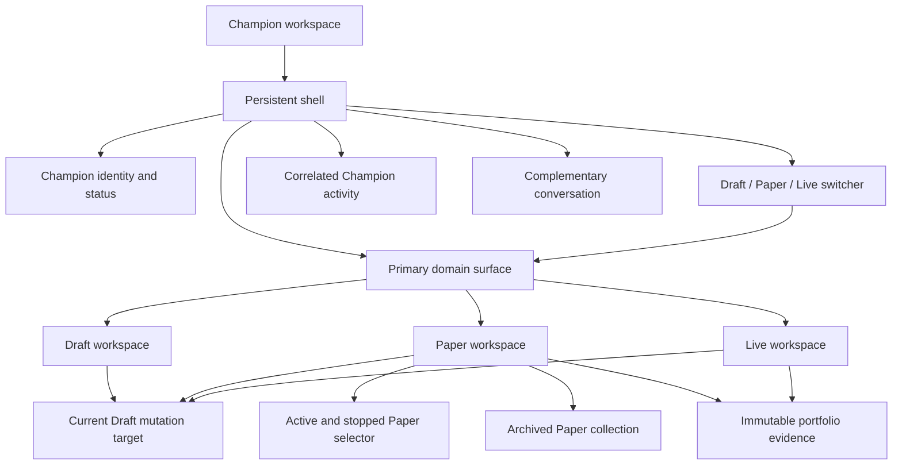

# Information Architecture

## Status

Accepted for the Champion workspace hierarchy and the two priority journeys.

**Viewport support remains Proposed under P-001.** The layout behavior in this document is the proposed desktop-first policy; exact supported widths and any mobile capability must be decided before layout implementation is accepted.

## IA Objective

> Keep intent, strategy, evidence, and iteration close together while making development, simulated operation, and capital-bearing operation unmistakably different.

The IA is organized around user goals—Draft, Paper, and Live—not backend entities. Versions, checkpoints, commands, deployments, and runs appear where they help the user understand or act; they are not peer top-level destinations.

The active domain surface—not the transcript—is the center of the workspace. Conversation is a contextual control and explanation channel correlated with the strategy, evidence, activity, and outcomes visible in that surface.

## Persistent Champion Workspace

The Champion workspace persists while the selected Draft, Paper portfolio, Live surface, or detail view changes.



### Persistent shell responsibilities

- Champion identity, availability, and current activity.
- Draft/Paper/Live switcher with explicit `Developing` and `Running` labels.
- Current operational, freshness, and authorization status when material.
- A primary domain surface whose identity, status, current work, and next meaningful action remain legible without conversation.
- Complementary conversation whose prompt, references, and attached context adapt to the viewed surface.
- Correlated Champion activity that exposes verified work phases and resulting domain objects outside prose.
- Viewed-context and Draft-mutation-target labels adjacent to the composer.
- Notifications and activity that can collapse during data-dense work.
- Stable navigation and useful cached state while nested content changes.

The shell must not remount the Champion, reset conversation, reconnect transports solely because of navigation, or imply that changing views changes the strategy controlling a portfolio.

## Workspace Attention and Correlation Model

The layout must not resemble a general-purpose chat application with an attached preview. Its attention hierarchy is:

1. **Primary domain surface:** the structured Draft, Evaluation result, Paper portfolio, run/decision trace, comparison, or Live risk/control view.
2. **Correlated work and activity:** what the Champion or system is doing, which object it affects, what completed, and what requires attention.
3. **Conversation:** intent, clarification, explanation, and contextual requests.

On wide supported viewports, conversation may remain beside the primary surface, but the primary surface receives the majority of usable workspace and first focus. When space is constrained, conversation collapses into a restorable panel or drawer before domain identity, evidence, or consequential controls are reduced. Exact dimensions remain P-001.

### Bidirectional correlation

Conversation and domain work remain synchronized without duplicating authority:

```text
Message or direct workspace action
→ intent / activity
→ proposed change, Evaluation, or analysis
→ authoritative domain result
→ visible artifact, evidence, or outcome
```

- A message that initiates work shows typed references to its activity, change set, Evaluation, run, or eligibility result.
- Champion progress appears in the activity system and on the affected domain surface, not only as streaming prose.
- A completed result materializes in its canonical surface. Chat summarizes and links to it instead of becoming the only place it can be inspected.
- Selecting a reference in conversation opens, focuses, or highlights the corresponding object in the primary surface.
- `Ask Champion`, `Explain`, and `Improve in Draft` actions launched from an object attach that exact object, immutable source, and data cutoff to conversation.
- Semantic changes highlight the affected structured strategy sections and remain in History even if the originating message is not visible.
- Collapsing, virtualizing, reconnecting, or failing conversation does not hide or cancel accepted work; authoritative status comes from domain events and queries.

Chat is never a top-level route, the sole progress indicator, the only approval surface, or the only record that a change, Evaluation, run, order, or deployment occurred.

## Conceptual Navigation Hierarchy

```text
Champions
└── Champion Workspace
    ├── Draft Vn · Developing
    │   ├── Strategy                  default
    │   ├── Experiments               evaluations and backtests
    │   ├── History                   checkpoints and immutable versions
    │   └── Data                      advanced
    ├── Paper
    │   ├── Active and stopped portfolio selector
    │   ├── Compare portfolios
    │   ├── Archived portfolios      secondary searchable collection
    │   └── Selected Paper Vn · Running
    │       ├── Overview              default
    │       ├── Runs
    │       ├── Positions
    │       ├── Orders
    │       └── Strategy Vn           read-only, exact source checkpoint
    └── Live · Running Vn
        ├── Overview                  default
        ├── Risk
        ├── Positions
        ├── Orders
        ├── Runs
        └── Strategy Vn               read-only
```

One Live destination is shown per Champion in the initial IA. This does not establish a permanent backend limit. Multiple Paper portfolios are first-class and remain independently selectable and comparable.

### Route identity rules

- Use stable Champion, portfolio, run, and experiment identifiers for routing; display labels such as `Paper V5` are not entity identifiers.
- Keep Draft, Paper, and Live routes beneath the persistent Champion layout.
- A selected Paper portfolio remains addressable so run, decision, and comparison context can be shared or restored.
- Deep links restore the viewed context and then resolve the current Draft mutation target independently.
- Unauthorized, deleted, stopped, or unavailable resources render an explicit state within the shell rather than silently redirecting to a different financial context.

Exact URL syntax is an implementation concern; these identity and persistence rules are the contract.

## Workspace Switcher

The switcher answers three questions without opening another view:

| Item | Primary label | Required secondary state | Behavior |
|---|---|---|---|
| Draft | `Draft V8` | `Developing · checkpoint V8.4` | Opens the current mutable Draft. |
| Paper | `Paper` or selected `Paper V5` | `Running V5` plus operational state | Opens the selected/recent Paper; exposes all Paper portfolios and comparison. |
| Live | `Live` | `Running V3` plus risk/operational state | Opens Live overview or readiness state if Live does not exist. |

The number communicates strategy generation; the state word communicates what is happening. Draft, Paper, and Live must remain distinguishable without custom color.

## Draft Workspace: Create and Test

### Default information order

1. Draft identity, checkpoint, and validation state.
2. Strategy objective, structured content, and correlated Champion explanation.
3. Universe, entry/exit behavior, sizing, risk, schedule, assumptions, and exclusions.
4. Most recent semantic change set.
5. Immediate evaluation or backtest action.
6. Recent evidence and comparison with its baseline.
7. Advanced configuration and raw detail.

### Primary actions

- Empty/new Draft: `Describe what you want` or select a transparent starter.
- Coherent Draft without evidence: `Test Draft Vn`.
- Changed Draft with prior evidence: `Evaluate changes`.
- Paper eligibility satisfied under D-027: `Launch Draft Vn to Paper`.

Strategy review and the first evaluation result remain inline on the default Strategy surface. Experiments provides history and depth; it must not be a required detour for the core loop.

### Secondary destinations

- **Experiments:** quick evaluations, dry runs, backtests, assumptions, results, and comparison.
- **History:** restorable checkpoints, immutable strategies, semantic changes, and provenance. Selecting `Restore checkpoint V8.2` opens a semantic restore review against the current checkpoint; acceptance creates the next checkpoint rather than rewinding history.
- **Data:** datasets, universes, benchmarks, and advanced assumptions. Keep secondary during onboarding.

## Paper Workspace: Learn and Compare

Paper is a persistent simulated portfolio, not a run. It is optimized for understanding whether an immutable strategy behaves as intended over time.

### Overview information order

1. `Paper Vn`, simulated-capital label, exact immutable strategy, and source checkpoint.
2. Operational state, freshness, schedule, and next expected run.
3. Champion assessment with evidence links.
4. Performance, drawdown, exposure, activity, inactivity, and limitations.
5. Latest meaningful run or event.
6. Comparison entry point.
7. Positions and orders summaries.

### Paper navigation

- **Overview:** current evidence and Champion assessment.
- **Runs:** scheduled cycles, decisions, trades, no-trades, failures, and source data cutoff.
- **Positions:** simulated holdings and exposure.
- **Orders:** simulated order history and status.
- **Strategy:** frozen read-only Strategy Vn, source Draft Vn · checkpoint Vn.x, semantic changes, and provenance.
- **Compare:** a Paper-level action for selecting multiple persistent portfolios; it need not be repeated as a tab inside every selected portfolio.
- **Archived:** a Paper-level collection of stopped portfolios retained for history and comparison without scheduled runs or full-resolution subscriptions.

Runs precede Positions and Orders in Paper navigation because learning why the strategy acted is the primary job. A run detail defaults to its decision trace, not raw logs.

### Primary actions

- Portfolio overview: `Review latest run` or, when a result is selected, `Improve in Draft Vn`.
- Run/no-trade detail: `Ask Champion about this run` and `Improve in Draft Vn`.
- Comparison: `Continue observing` or `Evaluate learning in Draft Vn`.
- Active Paper: `Stop future Paper runs` with explicit schedule impact and preserved evidence.
- Stopped Paper: `Archive Paper portfolio`; archive is reversible and deletion is not offered in the MVP.

Existing Paper portfolios remain unchanged when a newer Draft is evaluated or launched to Paper. Each Paper launch creates another independently observable source of evidence.

### Paper lifecycle interaction placement

Lifecycle controls stay secondary to learning and iteration. They must be discoverable without competing visually with `Review latest run`, `Improve in Draft`, or comparison.

| Portfolio state | Paper selector | Portfolio detail | Available lifecycle action |
|---|---|---|---|
| Active | Visible with `Running` status | Overview header overflow or settings area | `Stop future Paper runs` |
| Stopping | Visible with `Stopping` status | Persistent progress/status; evidence remains usable | No duplicate stop or archive action |
| Stopped | Visible in a `Stopped` subsection until archived | Read-only evidence with stopped time and last completed run | `Archive Paper portfolio` or explicitly resume if supported |
| Archived | Removed from active and stopped selector groups | Opened from the Paper-level `Archived` collection | `Unarchive`; returns to Stopped and never resumes automatically |

The Paper switcher ends with a secondary `Archived` entry that shows a count and opens a searchable collection. Archived portfolios do not appear alongside active comparison candidates by default, but the comparison picker may include them through an explicit `Include archived` filter.

`Stop future Paper runs` opens a scoped confirmation that states:

- No new scheduled runs begin after the stop is accepted.
- A run already executing may reach a terminal state unless a separately supported cancellation action is chosen.
- Simulated positions, immutable strategy, runs, decisions, orders, and performance evidence are preserved.
- Stopping does not change the current Draft, Live, or another Paper portfolio.

After the authoritative stop result, show `Archive Paper portfolio` in the stopped portfolio's overflow/settings area and optionally in its selector-row context menu. Archive confirmation explains that the portfolio leaves the everyday selector, loses scheduled work and full-resolution subscriptions, and remains searchable, inspectable, and available as historical comparison evidence.

Archiving an Active or Stopping portfolio in one action is not offered. Unarchive is also explicit and authoritative; it returns the portfolio to Stopped so resuming scheduled runs, if supported, requires a separate action and confirmation.

### Comparison validity

Paper comparison is descriptive until a declared evidence envelope is satisfied. The comparison shows the common observation window, market/regime overlap, schedules, completed runs, trade/no-trade activity, data quality, capital assumptions, and material strategy differences.

When P-008 thresholds are not met, label the result `Insufficient comparable evidence`. Show differences, but do not rank portfolios, declare a winner, recommend Live, or let Champion prose imply that one strategy is superior. Full-lifetime metrics remain secondary when lifetimes differ.

## Live Workspace: Control and Risk

Live is optimized for capital visibility, risk, pending actions, and operational control rather than experimentation.

### Overview information order

1. Live status and exact immutable strategy controlling future operation.
2. Capital, cash, exposure, risk status, and freshness.
3. Pending orders/actions and next scheduled execution.
4. Material recent decisions and outcomes.
5. Operational warnings and required action.
6. Positions, orders, runs, and read-only strategy detail.

### Live navigation

- **Overview:** capital, exposure, pending activity, and recent events.
- **Risk:** constraints, current utilization, warnings, and breaches.
- **Positions:** holdings and concentration.
- **Orders:** pending, eligible for cancellation, filled, rejected, and historical orders.
- **Runs:** decision cycles and explanations.
- **Strategy:** exact read-only strategy and provenance.

### Primary and emergency actions

- Normal state: `Review Live Vn` or `Prepare changes in Draft Vn`.
- Candidate satisfying the current D-027 policy: `Review Paper Vn for Live`; promotion remains a separate review journey.
- Emergency: `Pause future Champion executions` and `Cancel eligible open orders` are separate controls with distinct consequences, confirmations, permissions, and audit results.

Editing the Draft never serves as an emergency control and never alters Live directly.

## Journey 1 IA: Onboarding to Value

The onboarding route keeps the core sequence on the Draft default surface until Paper launch.

| Stage | Default surface | Primary content | Primary action | Trust signal |
|---|---|---|---|---|
| Orientation | Empty Draft | Champion capability, no-money-at-risk state, intent prompt, transparent starters | Describe intent / choose starter | Clear Paper versus Live language |
| Intent | Conversation + Draft shell | Material questions and declared defaults | Create Draft | No portfolio created |
| Understand | Draft Strategy | Structured rules, risks, assumptions, exclusions, explanation | Test Draft | Current Draft/checkpoint visible |
| Evidence | Inline evaluation | Actions, rejections, risk, window, benchmark, capital, cutoff, limitations | Revise or launch Paper | Infrastructure failure separated from poor performance |
| Paper review | Paper launch review | Exact checkpoint, immutable snapshot, schedule, simulated capital | Confirm Paper launch | Explicitly no real capital |
| Activated | Paper Overview | Running Paper V1, frozen strategy, first useful next action | Review first/latest run | Draft V2 shown separately |

Do not require navigation to Data, History, raw logs, broker setup, or Live configuration before activation. Users may open deeper details, but the next action returns to the core path.

## Journey 2 IA: Rigorous Iteration

Iteration begins from evidence and returns to evidence; it does not begin from a generic settings screen.

| Stage | Viewed context | Persistent context/action | Destination |
|---|---|---|---|
| Observe | Paper/Live overview, comparison, run, decision, order, risk, or no-trade | Exact portfolio, strategy, run, cutoff, and selected observation | Explanation in place |
| Trace | Run decision trace | Rule evaluations, action/rejection, immutable rule, source checkpoint | `Improve in Draft Vn` |
| Transfer | Original evidence remains attached to conversation | `Viewing … · Changes go to Draft Vn · checkpoint Vn.x` | Current Draft semantic proposal |
| Resolve drift | Source version compared with current Draft | Compatible application or domain-language conflict choices | Server-validatable proposal |
| Review change | Draft Strategy | Motivation, change, benefit, downside, unchanged constraints, provenance | Accept/reject change set |
| Test | Inline evaluation/Experiments | Baseline, assumptions, risk, behavior, limitations | Revise or launch new Paper |
| Compare | Paper comparison | Common window, source checkpoints, behavior, risk, activity, limitations | Continue observing or request Live review |
| Capital review | Separate Live promotion review | Exact tested strategy, evidence sufficiency, impact, warnings, destination | Explicit confirmation |

### Context transfer contract

`Improve in Draft` carries enough information to restore and audit the observation:

- Champion and portfolio.
- Paper or Live strategy version and source Draft checkpoint.
- Run, decision, order, trade, or no-trade reference.
- Relevant rule evaluations and market-data cutoff.
- Selected observation or user question.

The source remains immutable. If it differs materially from the current Draft, show the comparison and conflict before offering a change.

## Viewed Context Versus Mutation Target

This distinction is persistent, not a one-time warning.

| Viewed surface | Analysis context | Strategy mutation target | Required composer treatment |
|---|---|---|---|
| Draft V8 · checkpoint V8.4 | Current Draft | Draft V8 · checkpoint V8.4 | `Developing Draft V8 · checkpoint V8.4` |
| Paper V5 overview | Paper V5 evidence | Draft V8 · checkpoint V8.4 | `Viewing Paper V5 · Changes go to Draft V8 · checkpoint V8.4` |
| Paper V5 Run 42 | Run 42 and Strategy V5 | Draft V8 · checkpoint V8.4 | Preserve the run reference visibly |
| Live V3 | Live V3 evidence and risk | Draft V8 · checkpoint V8.4 | `Viewing Live V3 · Changes go to Draft V8 · checkpoint V8.4` |
| Paper comparison | Selected immutable portfolios | Draft V8 · checkpoint V8.4 | List compared versions; one Draft target |

An explanatory question does not create a checkpoint. When the Champion proposes a strategy change, the semantic change-review surface identifies the target again before acceptance. Server validation and the authoritative patch determine whether the Draft changed.

## Novel Decision Surfaces

### Semantic change review

This is a first-class domain surface, not a generic confirmation dialog. It shows:

- Draft target and current base checkpoint.
- Related commands grouped into understandable strategy changes.
- Motivation and linked evidence.
- Expected benefit and possible downside.
- Unchanged constraints.
- Required follow-up test.
- Proposed, validating, accepted/applied, rejected, failed, stale, or superseded status.

### Version-conflict resolution

When old evidence or offline work conflicts with the current Draft, show:

- Immutable source and current Draft side by side in domain language.
- The rule or assumption that diverged.
- Why direct application is incompatible or redundant.
- Safe choices that the server can validate, including keeping the current Draft, adapting the learning, or cancelling the proposal.

Do not expose silent overwrite, raw JSON merge, or a second active Draft branch as an MVP choice.

### Eligibility review

Paper launch and Live promotion render the versioned server eligibility assessment rather than inferring readiness in the browser. Show:

- Policy version and exact Draft checkpoint or Paper strategy assessed.
- Satisfied, missing, failed, stale, and advisory criteria.
- The evidence, data cutoff, authorization, risk, and operational input behind each criterion.
- Whether reassessment is required before confirmation.
- The remediation or observation still needed.

Missing hard Live criteria block the standard MVP promotion path. The Champion may explain the assessment but cannot alter it or replace it with a recommendation.

## Operational, Loading, and Error States

Every primary route renders one of these states without losing the persistent shell or changing financial context unexpectedly.

| State | User-visible requirement | Safe action |
|---|---|---|
| Loading | Identify what is loading; retain known identity and context | Wait or navigate elsewhere |
| Empty | Explain why no entity/evidence exists and show one next action | Create, test, or return |
| Stale | Show last update and that displayed data may be outdated | Retry/reconnect; avoid implying currentness |
| Offline | Preserve local pending work and base checkpoint; Paper/Live are read-only cached context | Reconnect or continue recoverable Draft work |
| Provisioning | State destination and progress without calling it active | Cancel if supported or wait |
| Active | Show fresh status and next expected operation | Normal contextual action |
| Paused | State that future Champion executions are paused and clarify open-order status | Resume if authorized; manage orders separately |
| Degraded | Explain impaired capability and affected data/actions | Retry, inspect details, or use safe controls |
| Disconnected | Show loss of live updates, last confirmed state, and reconnection progress | Reconnect; do not present cached values as live |
| Failed | Separate infrastructure failure from strategy outcome | Retry, preserve candidate/source, or contact support |
| Unauthorized/session expired | Remove or obscure unauthorized projections and stop protected streams | Re-authenticate or leave workspace |
| Recovering/reconciling | Show snapshot/backfill progress and temporary freshness limits | Wait; block conflicting consequential actions |
| Stopped/closed | Preserve historical evidence and state that no future operation occurs | Inspect history, archive Paper, or create a new destination |
| Archived Paper | Remove from the active selector, stop schedules/subscriptions, and retain provenance | Inspect, compare descriptively, or restore to stopped history |

Command, Paper-launch, and Live-promotion failures leave the previous authoritative Draft, Paper, and Live state intact. A failed Paper or Live transition must not land on a partially active success view.

## Progressive Disclosure

| Moment | Keep primary | Reveal on demand | Defer until needed |
|---|---|---|---|
| First entry | Champion, no-money-at-risk state, intent, starter assumptions | How starters work | Data plumbing, checkpoints, raw commands |
| First Draft | Objective, rules, risk, assumptions, explanation, test | Full strategy sections, latest semantic diff | Advanced datasets and technical schema |
| Evaluation | Actions/rejections, behavior, risk, assumptions, limitations | Detailed trades, regime slices, raw observations | Engine diagnostics |
| Paper | Running version, source checkpoint, assessment, runs, comparison | Positions, orders, full strategy | Low-level telemetry |
| Live | Capital, exposure, risk, pending actions, version, freshness | Full positions/orders/runs/strategy | Operational diagnostics unless degraded |
| Conflict | Source/current semantic difference and safe choices | Full provenance | Raw command or JSON diff for support only |

Progressive disclosure must not hide material assumptions, warnings, capital impact, authorization, freshness, or the identity of the strategy in control.

## Viewport and Panel Policy — Proposed (P-001)

### Proposed behavior

- **Wide desktop:** persistent Champion/navigation region, primary workspace, and contextual conversation can appear simultaneously.
- **Constrained desktop:** preserve the primary workspace; collapse conversation into a restorable panel and reduce navigation to a compact rail before removing financial context.
- Conversation, notifications, and secondary detail may collapse, but Draft/Paper/Live identity, operational state, freshness, and consequential-action feedback remain visible.
- Opening and closing panels restores focus predictably and preserves conversation/context.
- Dense tables and charts adapt or scroll without clipping risk, order, version, or confirmation information.

### Decisions required before layout implementation is accepted

- Minimum supported CSS viewport width and height.
- Supported browser/device matrix and representative test devices.
- Exact panel-collapse order and breakpoints.
- Whether widths below the minimum receive a read-only portfolio experience, a reduced workflow, or an explicit unsupported notice.
- Whether any mobile experience can perform strategy changes, Paper launch, Live promotion review, or emergency controls.
- Keyboard, screen-reader, zoom, and reduced-motion behavior at each supported layout.

Until these are recorded in the decision ledger, “responsive” must not be used as an unqualified acceptance claim.

## Search, History, and Deep Detail

- Virtualize long conversations, runs, orders, positions, and activity histories.
- Provide application-level search/filtering where off-screen virtualized content is unavailable to browser find.
- Search results retain entity type, Champion, portfolio/version, timestamp, and operational context.
- Opening a result does not change the current Draft target merely because it opens old evidence.
- Deep links and back navigation restore selection, scroll position where practical, and the source context attached to conversation.

## Traceability to Priority Journeys

| IA surface | Onboarding contribution | Iteration contribution |
|---|---|---|
| Persistent shell | Orientation and stable Champion identity | Preserves conversation and context across evidence and Draft |
| Draft Strategy | Creates understandable first strategy and inline evidence | Reviews semantic proposal and tests current checkpoint |
| Experiments | Stores deeper first-test detail | Compares hypothesis with baseline |
| Paper Overview | Activation destination and first running evidence | Ongoing observation and improvement entry point |
| Run decision trace | Explains initial action/rejection | Establishes precise causal source for improvement |
| Paper comparison | Not required before first activation | Tests improvements longitudinally without replacing history |
| Paper archive collection | Not shown in the core activation path | Bounds active Paper clutter while preserving historical evidence |
| Live Overview/Risk | Excluded from required first-session flow | Supports separate capital decision and ongoing control |
| Contextual conversation | Captures intent and explains evidence | Transfers immutable evidence to the current Draft |
| Semantic change review | Makes Champion-selected changes understandable | Preserves deliberate, evidence-linked improvement |
| Conflict resolution | Handles interrupted/stale onboarding safely | Prevents old evidence from silently overwriting the latest Draft |

## IA Acceptance Checks

- A first-time user can reach Paper without opening advanced Data, raw History, or Live configuration.
- The default Draft surface keeps strategy, latest changes, evidence, and the next test action close together.
- A user can distinguish Draft Vn, Paper Vn, and Live Vn without color.
- Every Paper and Live view exposes the exact immutable strategy in control and its source checkpoint.
- A Paper or Live observation can reach `Improve in Draft` without losing its run and rule context.
- The composer always exposes viewed context and mutation target when they differ.
- Collapsing conversation leaves Champion activity, current work, domain results, authority, and the next meaningful action visible in the primary surface.
- Paper navigation prioritizes runs and learning; Live navigation prioritizes risk and control.
- Active Paper can be stopped from its detail context; only Stopped Paper can be archived; Archived Paper is discoverable outside the everyday selector and unarchives without resuming.
- No-trade, stale, degraded, disconnected, unauthorized, and failed states remain understandable and actionable.
- Emergency pause and eligible-order cancellation cannot be mistaken for strategy editing or each other.
- Collapsed panels, deep links, and warm navigation preserve context and restore focus.
- The two priority journeys can be completed with keyboard-only navigation at every supported viewport.
- The viewport decision is resolved and recorded before responsive layout acceptance.
