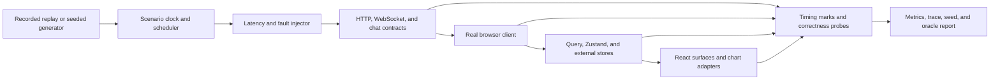

# Performance Simulation

## Status

Accepted as the validation approach for frontend responsiveness and live-latency behavior. Initial load values are scenario configuration, not product capacity claims. Numeric budgets become gates only after representative baselines are measured and reviewed.

## Purpose

The frontend must remain understandable and interactive while market, portfolio, Champion, command, and chat events arrive with realistic latency and faults. A deterministic contract-level backend simulator provides repeatable evidence before a production backend or production load is available.

This work validates the browser against frontend-facing behavior. It does not prescribe production backend internals, database design, event-bus technology, or execution capacity.

## Goals

- Reproduce the same event sequence, timing profile, and failure from a recorded seed.
- Exercise the real HTTP, WebSocket, and streamed-chat clients rather than replacing stores with component mocks.
- Measure the full browser path from transport receipt through store application to visible paint.
- Prove final-state correctness after duplication, reordering, gaps, disconnect, and backfill.
- Detect broad React rerenders, blocked input, dropped visual work, stale displays, memory growth, and subscription leaks.
- Compare active, warm, and cold Champion behavior under load.
- Separate protocol capacity from browser rendering performance.
- Produce artifacts an engineer can use to reproduce a regression locally.

## Non-Goals

- Certifying the throughput of a future production backend.
- Using real brokerage credentials, customer conversations, or production portfolios.
- Inventing a product latency SLA before representative measurement.
- Making every generated event visible; frame-conflation is expected for high-frequency telemetry.
- Treating a single fast laptop, headless browser, or average percentile as sufficient evidence.

## Simulator Boundary

One simulator exposes the same categories of contract the frontend expects in production:

- HTTP snapshots and paginated histories.
- Typed command submission and asynchronous outcomes.
- WebSocket market, portfolio, Champion activity, risk, and command-result channels.
- Streamed chat text and structured message parts.
- Authentication, authorization, session expiry, and reconnect outcomes needed for frontend tests.

Exact payloads remain a later contract decision. The simulator and frontend share versioned schemas or generated contract fixtures so incompatible changes fail visibly.



## Determinism Model

Every scenario records:

- Scenario name and schema version.
- Random seed and deterministic logical clock.
- Initial snapshot and logical sequence boundaries.
- Actors, portfolios, instruments, histories, and subscription set.
- Event schedule, payload-size distribution, and chat token schedule.
- Latency, jitter, burst, error, disconnect, duplication, and reordering configuration.
- Command decisions and expected authoritative outcomes.
- Browser, build, device profile, and simulator versions.

Seeded generation must produce the same logical events and expected final state. Browser wall-clock durations may vary and are measured statistically.

Recorded replay uses synthetic or explicitly sanitized events. Sanitization must remove customer identifiers, conversations, account values, credentials, and proprietary strategy content unless a separately approved fixture policy permits them.

## Load Dimensions

Scenarios can vary independently:

- Active Champions and warm/cold Champion inventory.
- Portfolios, subscriptions, and instruments per portfolio.
- Initial chart points and history-page sizes.
- Market, portfolio, Champion, risk, and order event rates.
- Burst duration, burst size, and message size.
- Chat tokens per second, message length, and structured parts.
- Concurrent query and command count.
- Command acknowledgement and authoritative-patch delay.
- Snapshot latency, server think time, bandwidth, jitter, and packet-like pauses.
- Duplicate events, logical reordering, missing sequence ranges, and stale snapshots.
- Disconnect frequency, reconnect backoff, backfill volume, and session expiry.
- Test duration and user interactions during load.

Configuration uses explicit units and distributions. Avoid a single opaque `stress level` control.

## Named Profiles

| Profile | Purpose | Characteristic pressure |
|---|---|---|
| Normal | Establish the reference experience | Moderate continuous events, low jitter, successful commands |
| Market open | Test a predictable burst | High market/portfolio burst while navigation and chat remain active |
| Volatility | Stress rapid and uneven change | Bursts, larger deltas, risk changes, orders, and Champion activity |
| Slow commands | Validate authority language | Fast chat with delayed acknowledgement and delayed authoritative patch |
| Degraded network | Validate stale and recovery UX | Latency, jitter, timeouts, partial errors, and intermittent connection |
| Reconnect storm | Validate backoff and reconciliation | Many connections drop, re-authenticate, snapshot/backfill, and recover |
| Cold first visit | Measure progressive value | Large snapshot, chart history, conversation, and event catch-up |
| Warm Champion switch | Measure retained state | Repeated switching across active and warm tiers under background events |
| Large histories | Validate virtualization and search | Long runs, orders, messages, positions, and comparison data |
| Session change | Validate secure failure | Expiry, revoked authorization, cross-tab logout, and reconnect denial |
| Soak | Find leaks and unbounded queues | Hours of representative events, navigation, reconnect, and history growth |

Each profile has a small default fixture for local development and scale parameters for scheduled/staging runs. Rates are deliberately not hard-coded in this architecture document.

## Fault Model

The simulator must create faults at contract boundaries, not merely slow the whole process:

- Delayed, failed, and stale HTTP snapshots.
- A WebSocket disconnect before, during, and after a command outcome.
- Duplicated events and duplicated delivery after reconnect.
- Logical out-of-order events within configured channel rules.
- Missing sequence range requiring backfill.
- Snapshot older than already buffered deltas.
- Command acknowledgement without immediate patch.
- Authoritative rejection after optimistic Draft presentation.
- Chat completion while the related domain command fails.
- Token stream interruption and resumable/non-resumable outcomes.
- Session expiry and authorization loss during active subscriptions.
- Server overload responses and bounded retry hints.

Fault injection must never create behavior the production contract explicitly forbids without labelling the scenario as a robustness/fuzz test.

## Timing Envelope

### Event-to-paint

```text
server emission
→ browser transport receipt
→ validation and ordering
→ store application
→ subscriber notification
→ React commit or imperative chart draw
→ next painted frame
```

Capture marks for each available boundary. Use `performance.now()` for browser-local spans. Server-emission-to-browser-receipt requires synchronized clocks or a measured offset; report it separately from the reliable browser-local receipt-to-paint duration.

For a React value, associate the reconciled event identity with the commit containing that value and the next animation frame. For an imperative chart, mark the draw call and next frame. Sampling may be required at high rates, but the sample method and rate must be recorded.

### Command-to-confirmation

```text
user submit
→ request sent
→ acknowledgement
→ authoritative outcome received
→ projection reconciled
→ confirmed state painted
```

Measure acknowledgement and confirmation separately. The test fails functionally if the UI displays confirmation before the authoritative outcome, even when the latency number appears good.

### Snapshot-to-usable view

```text
navigation intent
→ shell or cached summary painted
→ snapshot received
→ minimum useful content painted
→ deep history and chart current
```

Define `minimum useful content` for each journey surface in the test fixture. It is not synonymous with all network activity becoming idle.

## Metrics

Report distributions and worst meaningful windows, not averages alone:

- p50, p95, and p99 receipt-to-paint and, where clock-safe, emission-to-paint.
- Navigation-to-shell and navigation-to-usable-view for active, warm, and cold tiers.
- Command submit-to-acknowledgement and submit-to-visible-confirmation.
- Chat time to first part, token cadence, completed-response paint, and composer input delay.
- Snapshot/backfill duration and reconnect-to-current duration.
- Data freshness age by surface and time spent stale/degraded.
- Input responsiveness, INP observations, long tasks, and main-thread blocking time.
- Animation-frame misses and effective chart/display update rate.
- React commit count, duration, and affected subtree for instrumented surfaces.
- Store/worker queue depth and event processing time.
- Events received, deduplicated, logically applied, visually conflated, sampled, rejected, and dropped unexpectedly.
- Heap trend, DOM nodes, listeners, subscriptions, chart points, query entries, and IndexedDB queue growth.
- Error, retry, reconnect, authorization, and failed-oracle counts.

Visual conflation is not an error when policy permits it. Unexpected loss of a command, risk, order, provenance, or state-transition event is always an error.

## Correctness Oracles

Performance results are valid only if correctness oracles pass.

### Final-state equivalence

After a scenario settles, compare normalized browser state with the simulator's expected state for:

- Draft/checkpoint identity.
- Portfolio value and operational status.
- Positions, eligible orders, runs, and deployments.
- Chart terminal value and configured history window.
- Command terminal states.
- Conversation messages and structured confirmed parts.
- Freshness and connection state.

An uninterrupted replay and a disconnect/backfill replay with the same seed must converge to the same normalized state without duplicate effects.

### Invariants

- Sequence gaps cannot be silently marked current.
- Duplicate delivery cannot create duplicate trades, runs, messages, or notifications.
- Paper and Live never change from Draft commands.
- Acknowledgement cannot appear as application or execution.
- An old snapshot cannot overwrite a newer buffered delta.
- Rejected optimistic Draft work returns to the confirmed projection and remains explainable.
- Session expiry stops protected live paths and cached state is not presented as currently authorized.
- Pausing executions and cancelling eligible orders remain distinct outcomes.
- Viewed context and mutation target remain correct through Champion and route switching.
- Run and outcome provenance remains intact under pagination, virtualization, and backfill.

### Responsiveness probes

During peak profiles, the test repeatedly:

- Types in chat and strategy inputs.
- Opens and closes a domain dialog.
- Switches Draft/Paper/Live and active/warm/cold Champions.
- Scrolls and searches a virtualized history.
- Inspects a chart's accessible table.

The goal is to measure real journey interaction while streams are active, not an idle dashboard.

## Browser Instrumentation

- Use the User Timing API for named transport, store, commit/draw, and confirmation marks.
- Use `PerformanceObserver` for long tasks, event timing, layout shift where relevant, and supported responsiveness entries.
- Add development/test-only subscription and commit counters around domain surfaces.
- Expose a test-only normalized-state probe and event ledger that contains synthetic identifiers but no customer data.
- Capture browser console, network, screenshots, video when useful, and Playwright trace on regression.
- Record whether the run used headless or headed mode and hardware acceleration.
- Do not ship high-volume diagnostic hooks enabled in production by default.

The telemetry schema, correlation, sampling, redaction, and retention policy are tracked by P-011 and must be versioned when implemented.

## Playwright and k6 Roles

### Playwright

Playwright owns real-browser evidence:

- Priority journey completion under load.
- DOM, accessibility, keyboard, focus, and visible authority states.
- Browser receipt-to-paint, input responsiveness, render/commit behavior, and memory trends.
- Active, warm, and cold navigation.
- Reconnect, backfill, offline recovery, and session-expiry behavior.
- Traces that connect network events to visible failures.

Run performance-sensitive suites on controlled workers. Headless CI trends are useful, but representative headed/device runs are required before claiming user-facing budgets.

### k6

k6 owns protocol pressure:

- Concurrent snapshot, history, and command requests.
- WebSocket connection counts, channel traffic, reconnect patterns, and server-side latency/error behavior.
- Capacity tests against the simulator plumbing or a staging backend.

Use the current `k6/websockets` API for new WebSocket tests. k6 does not render React, measure paint, validate focus, or replace Playwright.

Run the two tools separately by default so a saturated load generator does not contaminate browser measurements. Combine them deliberately when testing a browser against a pressured staging system.

## CI Tiers

| Tier | Trigger | Scope | Result |
|---|---|---|---|
| Local | Developer command | One small deterministic profile and selected journey | Fast metric summary and failed oracle details |
| Pull request | Every relevant PR | Normal plus a short burst/reconnect smoke on one controlled browser | Correctness gate; performance trend until budgets are accepted |
| Scheduled | Nightly or scheduled | Named burst, degraded, cold/warm, large-history, and multi-browser profiles | Regression report and retained traces |
| Staging | Release candidate or manual | Representative browser devices plus k6 pressure, auth, and recovery | Release evidence against reviewed budgets |
| Soak | Manual or scheduled environment | Long representative scenario with repeated navigation and faults | Leak, queue, and memory-growth report |

A failed run retains build identity, scenario version, seed, full configuration, simulator log, browser trace, metric summary, correctness report, and normalized final-state diff.

## Baselines and Budgets

Do not invent thresholds from intuition.

1. Select representative devices, browsers, viewport, network conditions, and data shapes.
2. Run each accepted scenario enough times to estimate normal variance and warm-up effects.
3. Review distributions with product and engineering, including correctness and freshness tradeoffs.
4. Record a baseline version and the reason each proposed budget protects a user journey.
5. Introduce warning thresholds before blocking thresholds.
6. Fail CI only when an accepted absolute budget or statistically meaningful regression is exceeded on controlled infrastructure.
7. Re-baseline only through a recorded decision; never automatically bless a slower main branch.

Budgets should cover at least usable-view latency, receipt-to-paint, command-to-confirmation, input responsiveness, freshness, reconnect recovery, unexpected event loss, and memory/queue growth. p95 protects routine experience; p99 and worst-window inspection expose burst failures. Correctness invariants have zero tolerance regardless of percentile.

## Implementation Sequence

Build the simulator through the same vertical slices as the product (D-031), not as a complete backend substitute before the first journey works.

1. **Onboarding slice:** define the minimum versioned contract facade and deterministic scenario required for intent → Draft → evaluation → Paper, with an expected-state oracle and browser timing marks.
2. **Iteration slice:** add Paper runs, contextual improvement, command delay, comparison validity, and version-conflict scenarios.
3. **Live-safety slice:** add eligibility, authorization/session changes, risk review, pending commands, and emergency-control scenarios before any Live-capital implementation.
4. **Scale slice:** add market-open, volatility, cold/warm switching, reconnect/backfill, large-history, and accessibility-under-load profiles.
5. Add k6 protocol pressure and scheduled browser regression runs.
6. Measure representative baselines, record reviewed budgets, then enable performance gates.
7. Add soak tests and production-like staging only after the state and transport contracts stabilize.

## Security and Data Handling

- Simulator fixtures are synthetic by default.
- CI uses dedicated non-production credentials where authentication is required.
- Never include brokerage credentials, production API keys, customer prompts, account identifiers, or real portfolio data in fixtures or artifacts.
- Sanitize URL, header, message, screenshot, and trace contents before retention.
- Scope test authorization so simulator commands cannot reach a production service.
- Treat traces and heap snapshots as potentially sensitive artifacts with explicit access and retention.

## Acceptance Criteria

- A scenario can be replayed locally from its retained seed and configuration.
- The frontend uses production-shaped HTTP, WebSocket, and chat boundaries rather than direct store injection.
- Event-to-paint and command-to-confirmation stages are separately observable.
- All named profiles produce correctness-oracle results as well as performance metrics.
- Reconnect runs converge to uninterrupted state with no duplicate effects.
- Browser tests exercise chat, editing, navigation, virtualization, and chart alternatives while streams are active.
- Playwright and k6 results are reported as distinct forms of evidence.
- Pull requests run a bounded deterministic smoke suite; broader profiles and soak tests run at appropriate CI tiers.
- Budgets are derived from recorded representative baselines and cannot be silently re-baselined.
- No performance artifact requires or exposes production customer or brokerage data.

## Proposed Decisions

- P-003: event cursor, logical sequencing, reconnect, and backfill contract.
- P-010: representative devices, browsers, networks, scenario scales, controlled workers, synchronization, measurement methods, budgets, and variance.
- P-011: telemetry correlation, sampling, redaction, and artifact retention.

Whether the simulator runs in-process, as a local service, or both is an implementation choice unless it changes a frontend contract or accepted performance methodology.
