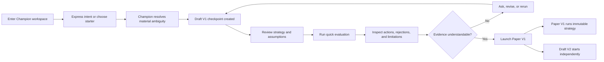
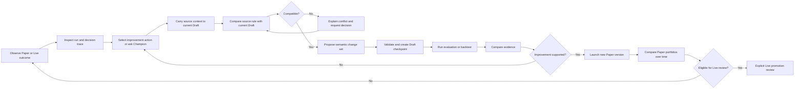

# Priority User Journeys

## Status

Accepted as the primary product-planning framework for the demo and initial product architecture.

## Priority

Vantheon planning must optimize two journeys in this order:

1. **Onboarding to value** — help a new user reach understandable strategy evidence and launch a safe Paper portfolio with minimal setup.
2. **Rigorous iteration** — help a user move from observed behavior to a tested improvement without losing provenance or accidentally changing deployed capital.

Every proposed feature must identify which journey step it improves, which measurable friction it reduces, and which trust guarantee it preserves. Work that supports neither journey is deferred unless it is required for security, compliance, accessibility, or system reliability.

## Shared Journey Principles

- The Champion is the persistent collaborator across Draft, Paper, and Live.
- The structured strategy, evidence, and operational surfaces are primary; conversation expresses intent, explains, and preserves provenance.
- Champion conversation remains visible in its secondary dock, while Champion work also materializes as correlated activity and canonical domain results. No journey depends on rereading a transcript to discover what happened.
- The next meaningful action is visible in context. Users should not need to understand the entity graph before receiving value.
- Assumptions, data cutoffs, strategy changes, and test conditions are visible before evidence is presented as meaningful.
- Paper and Live remain pinned to immutable strategies. New strategy work—whether initiated through conversation or a domain action—targets the current Draft.
- Viewed context and mutation target are always distinguishable.
- Inactivity, rejection, uncertainty, degradation, and failure are explained rather than hidden.
- Deeper configuration is progressively disclosed after the user reaches the first evidence milestone.

---

## Journey 1: Onboarding to Value

### User outcome

> I described what I want, saw the Champion turn it into an understandable strategy, observed credible evidence of how it behaves, and safely started testing it in Paper.

The activation milestone is not account creation or the first chat message. It is a running Paper portfolio whose strategy, assumptions, and initial evidence the user can explain at a basic level.

### Journey map



### Stage 1: Enter with orientation

The first Champion workspace view must answer:

- Who is the Champion?
- What can the Champion build or test?
- Is any real money currently at risk?
- What is the next useful action?

The default state offers both:

- An intent composer adjacent to the emerging structured Draft for users who already know their intent.
- Transparent starter patterns for users who need structure.

The first screen is not an empty full-page transcript. It establishes the Champion, Draft state, no-money-at-risk status, strategy structure, and next step before or alongside the first message.

Starter patterns are starting points, not promises or recommended investments. Each discloses its default universe, risk posture, time horizon, data window, benchmark, and simulated capital before testing.

### Stage 2: Capture intent with minimum friction

The user can describe goals in ordinary language. The Champion asks only questions whose answers materially affect strategy behavior, test validity, or risk.

Avoid requiring the user to configure every signal, data source, schedule, and risk parameter before seeing a Draft. The Champion may choose reversible defaults, but must identify them explicitly.

Success state:

- The user has submitted enough intent to create a coherent initial Draft.
- Unresolved material assumptions remain visibly marked.
- No Paper or Live action has occurred.

### Stage 3: Create an understandable Draft

The Champion produces a structured Draft V1 checkpoint rather than only a prose response.

The initial strategy view prioritizes:

- Objective and universe.
- Entry and exit behavior.
- Position sizing and exposure limits.
- Schedule and evaluation cadence.
- Important assumptions and exclusions.
- A short explanation of why these choices match the user's intent.

Technical schema details and advanced data configuration remain available but secondary.

Success state:

- The user can identify what the strategy is trying to do.
- The user can identify the main conditions that permit or prevent action.
- The current Draft and checkpoint are visible.

### Stage 4: Reach evidence quickly

Offer a quick evaluation using visible, Champion-selected defaults. Never silently run an arbitrary generic backtest and present it as validation.

Before execution, disclose:

- Evaluation type.
- Universe and benchmark.
- Historical or current time window.
- Starting capital and transaction assumptions.
- Market-data cutoff.
- Known limitations.

The evaluation returns more than a performance number. It shows:

- What the strategy evaluated.
- What it would have done.
- What it rejected and why.
- Risk and drawdown behavior.
- The D-027 Paper eligibility criteria and whether revision is required.

Success state:

- Evidence is visible without navigating through multiple technical sections.
- A user can ask the Champion about any result while retaining evaluation context.
- Failed or inconclusive evidence leads naturally back to Draft improvement.

### Stage 5: Launch Paper safely

The Paper action explains the lifecycle before confirmation:

```text
Draft V1 from checkpoint V1.x
→ immutable Strategy V1
→ Paper V1 begins simulated operation
→ Draft V2 checkpoint V2.0 begins independently with the exact launched strategy content
```

The confirmation shows the exact checkpoint, key assumptions, evaluation result, schedule, and simulated capital. It explicitly states that no real capital is involved.

The server eligibility assessment requires a structurally valid Draft, defined risk constraints and schedule, available data dependencies, disclosed assumptions, and at least one successfully completed transparent Evaluation. Zero trades do not block Paper because Paper exists to gather evidence.

After launch:

- The user lands in Paper V1 with the first useful next action visible.
- Paper V1 exposes its frozen strategy and source checkpoint.
- Draft V2 is available for continued development without changing Paper V1.
- The first semantic change to Draft V2 creates checkpoint V2.1; V2.0 is its generation baseline rather than a claimed improvement.

### Trust gates

- No ambiguous use of “Live,” “funded,” or “deployed” during simulated onboarding.
- No hidden defaults that materially affect evidence.
- No performance result without its test window and assumptions.
- No automatic transition from Paper to Live.
- No Draft edit can change Paper V1 after launch.

### Failure and recovery

- **Incomplete intent:** preserve the conversation and show the remaining material question.
- **Draft generation failure:** retain the user's intent and offer a retry without duplicating messages or checkpoints.
- **Evaluation failure:** distinguish infrastructure failure from poor strategy performance.
- **Offline interruption:** restore the pending command and its base checkpoint.
- **Paper provisioning failure:** leave the Draft and immutable strategy intact; do not create a partially active portfolio.

### Measures

- Time to first coherent Draft.
- Time to first understandable evidence.
- Time to first Paper portfolio.
- Number of required inputs before the first Draft and first evaluation.
- Evaluation completion and abandonment rates.
- Percentage of users who can correctly identify Draft versus Paper after launch.
- First-session questions or errors caused by version/checkpoint terminology.

Numeric targets are set only after instrumented baseline sessions on representative devices.

### Demo acceptance scenario

A new user can enter a Champion workspace, begin from natural-language intent or a starter, receive Draft V1, inspect a structured strategy, run a transparent quick evaluation, understand at least one action and one rejection, launch Paper V1, and see Draft V2 created separately without encountering Live-capital configuration.

---

## Journey 2: Rigorous Iteration Loop

### User outcome

> I observed what a strategy actually did, traced the result to its cause, made a deliberate improvement in the current Draft, tested the change, and compared the new evidence without altering anything already running.

The loop optimizes learning quality as well as speed. A faster loop that loses provenance, silently changes scope, or promotes weak evidence is a failure.

### Journey map



### Entry points

Iteration can begin from:

- A Paper or Live portfolio overview.
- A completed or failed run.
- A trade, order, rejection, or no-trade explanation.
- A risk, drawdown, exposure, or performance change.
- A Paper comparison showing meaningful divergence.
- A direct request in persistent conversation, correlated to the resulting activity and domain object.

Every entry point retains the observed source as immutable context.

### Stage 1: Observe and explain

The user should be able to move from a portfolio result to:

```text
Outcome
→ trade or inactivity
→ decision
→ run
→ immutable strategy rule
→ source checkpoint and originating change
```

No-trade outcomes are first-class evidence. The Champion explains what it evaluated, which conditions passed, which condition prevented action, and whether that behavior matched the strategy's intent.

Success state:

- The user can identify the exact immutable strategy responsible.
- The evidence distinguishes strategy behavior, data limitations, and infrastructure failure.
- The next improvement action retains this context.

### Stage 2: Transfer context to the current Draft

When the user selects `Improve in Draft`, carry:

- Champion and portfolio identifiers.
- Paper or Live strategy version.
- Source Draft checkpoint.
- Run and decision identifiers.
- Relevant rule evaluations and market-data cutoff.
- The user's selected observation or question.

The composer displays both:

```text
Viewing: Paper V5 · Run 42
Changes go to: Draft V8 · checkpoint V8.4
```

The user must never infer that conversation changed Paper V5 or Live V5.

### Stage 3: Resolve version drift

An observation from Paper V5 may arrive after the current Draft has advanced to Draft V8 at checkpoint V8.4.

MVP behavior:

1. Preserve V5 and its run as immutable evidence.
2. Compare the relevant Strategy V5 rule with its equivalent in Draft V8 at checkpoint V8.4.
3. Propose how the learning applies to the current Draft checkpoint.
4. If compatible, create a semantic change proposal against Draft V8 at checkpoint V8.4.
5. If incompatible or already superseded, explain why and request a user decision.
6. Do not overwrite Draft V8 at checkpoint V8.4, silently reconstruct Draft V5, or create a second active Draft branch.

### Stage 4: Review and apply a change set

The Champion presents a semantic change set rather than streaming authoritative strategy code into the browser.

Show:

- What changed.
- Why it changed.
- Which observation motivated it.
- Expected benefit and possible downside.
- Rules and constraints that remain unchanged.
- Required follow-up evidence.

The server validates and applies the accepted command set, then emits the authoritative patch and next restorable checkpoint.

Failure states include rejected validation, stale base checkpoint, incompatible command, interrupted execution, and superseded proposal.

### Stage 5: Test the hypothesis

Testing must answer whether the proposed improvement solved the observed problem without causing unacceptable regressions.

Compare against the relevant baseline:

- Previous Draft checkpoint.
- Source Paper strategy.
- Current Paper portfolios.
- Live strategy when preparing a promotion review.

Evidence includes behavior and risk, not only return:

- Decisions and rejected opportunities.
- Exposure and concentration.
- Drawdown and volatility.
- Turnover and trading frequency.
- Behavior across relevant market regimes.
- Test assumptions, data cutoff, and limitations.

### Stage 6: Launch and compare Paper versions

When evidence supports the change, launch the current Draft as a new immutable Paper version. Existing Paper portfolios continue unchanged.

As the Paper set grows, lifecycle housekeeping remains secondary to comparison: the user may stop a portfolio that should no longer gather new evidence, wait for any current run to finish, and archive it from the stopped state. Archiving removes it from the everyday selector without deleting its strategy, runs, decisions, or comparison provenance. Unarchiving returns it to Stopped and never restarts schedules automatically.

The comparison experience must support:

- Common and version-specific observation windows.
- Strategy and source-checkpoint differences.
- Run count and schedule differences.
- Risk, performance, activity, and inactivity.
- Champion assessment with evidence links.

It also declares a validity envelope covering the common window, regime overlap, schedules, completed runs, activity, data quality, and capital assumptions. Until P-008 thresholds are met, label the result `Insufficient comparable evidence`; do not rank, recommend, or declare a winner.

### Stage 7: Review for Live

Live promotion is a separate capital decision, not the automatic final step of iteration.

Before the review can proceed, the versioned D-027 server policy must confirm the exact Paper-tested strategy satisfies all hard evidence, operational, data, risk, freshness, and authorization criteria. The UI shows each criterion and blocks missing hard requirements; the Champion cannot override the assessment.

The review shows:

- Exact Paper-tested strategy and source checkpoint.
- Duration and quantity of Paper evidence.
- Material differences from the current Live strategy.
- Expected position, exposure, order, and risk impact.
- Known limitations and unresolved warnings.
- Explicit confirmation of the destination and capital at risk.

AI-generated review and automated tests provide evidence but never replace human confirmation.

### Trust gates

- Viewed portfolio and Draft mutation target remain visible.
- Running strategies remain immutable.
- Every proposed change links to its motivating evidence.
- A failed test does not silently advance Paper or Live.
- Paper comparison retains exact source checkpoints and test assumptions.
- Live promotion cannot bypass Paper evidence in the standard journey.
- Emergency pause and eligible open-order cancellation remain separate from strategy editing.

### Failure and recovery

- **Old evidence conflicts with current Draft:** explain the semantic conflict; preserve both states.
- **Command base is stale:** reconcile or request a decision before applying.
- **Evaluation is inconclusive:** preserve the hypothesis and show what additional evidence is needed.
- **Stream disconnects:** retain visible stale state, reconnect, backfill, and reconcile deterministically.
- **Paper or Live is degraded:** distinguish operational failure from strategy performance.
- **Promotion fails:** keep the previous deployment active and preserve the candidate strategy for retry.

### Measures

- Time from observed result to a contextualized Draft proposal.
- Time from proposal to evaluated checkpoint.
- Percentage of improvement actions that retain complete run provenance.
- Rate of version-target confusion or cancelled cross-context commands.
- Number of iterations required before launching a new Paper version.
- Paper comparison usage and evidence inspection depth.
- Frequency of detected semantic conflicts versus silent overwrites.
- Live-promotion abandonment, warning acknowledgement, and rollback/pause frequency.

### Demo acceptance scenario

A user opens a no-trade event in Paper V5 while Draft V8 is at checkpoint V8.4, traces the block to a specific V5 rule, transfers the full run context to the Champion, sees that changes target Draft V8 · checkpoint V8.4, receives a compatible semantic proposal, creates checkpoint V8.5, evaluates it against the prior behavior, launches Paper V8, and compares V5 and V8 without changing either running portfolio.

---

## Planning and Delivery Order

### Vertical slice 1: Onboarding to first evidence

- Champion entry and intent capture.
- Draft V1 structured artifact.
- Assumption disclosure.
- Transparent quick evaluation.
- Explanation of at least one action and rejection.

### Vertical slice 2: Evidence to Paper

- Paper launch review.
- Immutable strategy/source-checkpoint display.
- Draft V2 creation.
- First Paper overview and run.

### Vertical slice 3: Paper learning loop

- Run and decision trace.
- Context-preserving `Improve in Draft`.
- Semantic change proposal and checkpoint.
- Evaluation comparison.
- New Paper launch and Paper comparison.

### Vertical slice 4: Capital-control loop

- Live eligibility and promotion review.
- Risk and impact preview.
- Active, paused, degraded, and disconnected states.
- Separate emergency execution pause and eligible-order cancellation.

Infrastructure, component, and performance work should be scheduled inside these slices whenever possible rather than delivered as disconnected platform projects.

## Journey Review Checklist

Before approving a feature or architecture decision, verify:

- Which of the two priority journeys does it improve?
- Which journey stage owns it?
- What user-visible friction or risk does it address?
- What is the next meaningful action after this feature?
- Does it preserve viewed context, mutation target, and provenance?
- Does it introduce a new concept before the user needs it?
- Does failure leave Draft, Paper, Live, and capital in an understandable state?
- How will success and regression be measured?
