# State and Data-Flow Diagrams

## Status and Scope

Accepted as the visual companion to `docs/domain-model.md` and `docs/priority-user-journeys.md`.

These diagrams specify observable product and frontend contracts. They do not prescribe database transactions, endpoint shapes, service boundaries, or orchestration implementation. A backend may realize the flows differently only if it preserves the named states, authority boundaries, failure behavior, and provenance.

## Reading Rules

- Server-authoritative state changes occur only after validation and an authoritative result.
- A client proposal, streamed tool output, animation, cache entry, or optimistic projection is never proof of acceptance.
- Draft, portfolio, deployment, run, order, and connection states are independent state domains. One diagram must not be interpreted as silently changing another.
- Paper and Live strategies are immutable. Strategy-changing actions always target the current Draft.
- Labels such as `Paper V5` are concise presentation labels; exact source checkpoints remain available in detail views.
- A failure path preserves the last valid authoritative state unless the diagram explicitly shows a successful transition.

## State-Domain Owners

| State domain | Sole authoritative owner | Client responsibility |
|---|---|---|
| Draft, checkpoints, Draft change sets, and Draft mutation commands | Server strategy domain | Render projection, collect intent, preserve eligible Draft recovery commands |
| Immutable strategy | Server strategy domain | Render immutable projection and provenance |
| Portfolio, deployment, Paper launch, Live promotion, and operational controls | Server portfolio and deployment domain | Review, confirm, show freshness and risk, and reconcile authoritative status |
| Run and decision | Server execution domain | Stream progress and render durable evidence |
| Order and trade | Server execution domain, reconciling venue or broker events | Never imply acceptance or fill before authoritative event |
| Session and authorization | Server identity and authorization boundary | Re-authenticate, gate actions, and clear unauthorized projections |
| Market telemetry | Market or server stream | Conflate visual updates and communicate freshness |
| Local interaction state | Browser | Own selection, panels, focus, and disposable projections |
| Offline Draft recovery queue | Browser until accepted by the server strategy domain | Preserve eligible Draft commands and replay against their base checkpoint; never queue consequential portfolio controls |
| Simulator clock and scenario | Test harness | Record marks and produce reproducible reports |

---

## 1. Core Value Loop

The two priority journeys share one loop. Live remains an explicit capital decision rather than an automatic completion step.

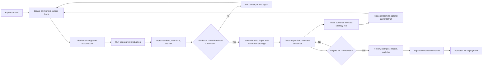

## 2. Draft Checkpoint Lifecycle

One accepted semantic Draft change set creates one checkpoint, regardless of its authorized initiator. Low-level commands inside the change set do not create separate user-facing checkpoints.

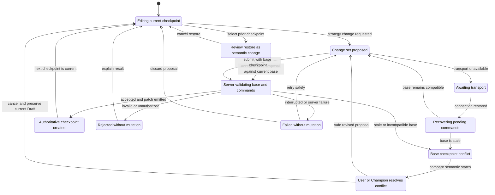

Non-mutating conversation remains in `Editing` and does not increment the checkpoint. Restoring V8.2 from current V8.4 follows `RestoreReview → Validating → Checkpointed` and creates V8.5 containing the restored content; it never rewinds the current pointer or deletes V8.3/V8.4.

## 3. Paper Launch

The authoritative launch commit exposes Strategy V5, active Paper V5, and Draft V6 at checkpoint V6.0 together. No client state should imply that the generation advanced before that commit.

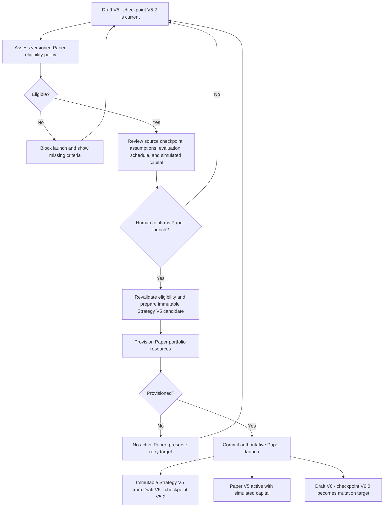

Existing Paper portfolios remain independent. A later Draft normally launches another Paper portfolio rather than rewriting Paper V5.

## 4. Live Promotion

Live promotion uses the exact Paper-tested strategy. The prior Live deployment remains in control unless the final activation succeeds.

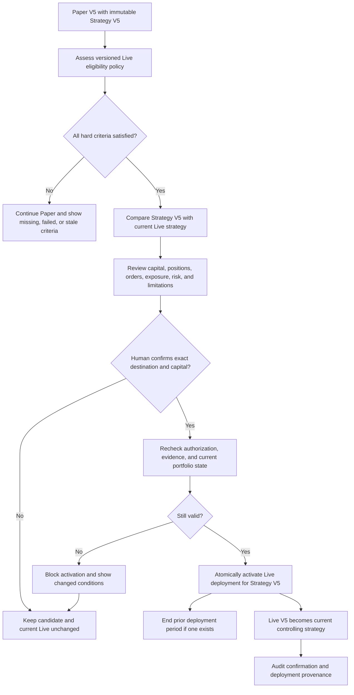

## 5. Deployment Lifecycle

Deployment state is separate from portfolio operational state. A paused portfolio can still have the same active deployment assignment. In the MVP, a Paper deployment remains pinned for that Paper portfolio; only a Live deployment can be superseded in place.

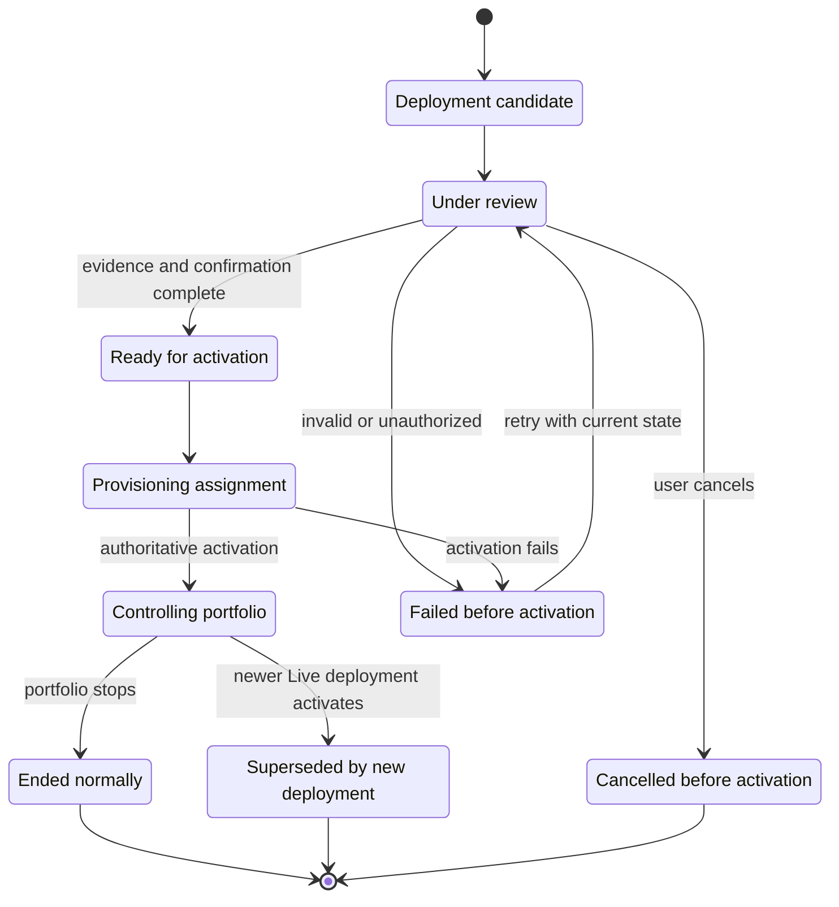

## 6. Cross-Version Learning

Old evidence remains immutable context. The learning is translated into a proposal against the one current Draft rather than recreating the old Draft or opening an MVP branch.

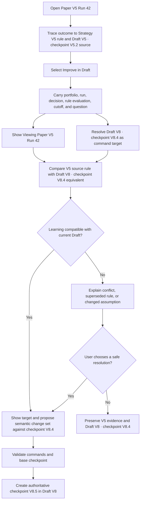

## 7. Correlated Champion Work and Command Flow

Conversation is one persistent presentation of work, not its owner. Its dock remains visible, while the primary domain surface and activity projection remain current through authoritative events if the conversation stream is loading, reconnecting, or unavailable.

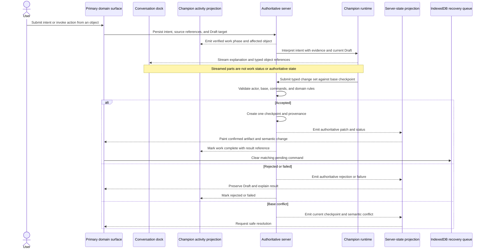

The conversation dock may summarize and link to the result, but the result is independently present in the primary surface and activity history. If transport is unavailable before submission, the browser preserves the pending command and its base checkpoint in the recovery queue. Reconnection replays it only after comparing that base with current server state.

## 8. Portfolio Run Lifecycle

A run records one execution cycle. Orders can outlive the run, so run completion does not imply that every accepted order has filled.

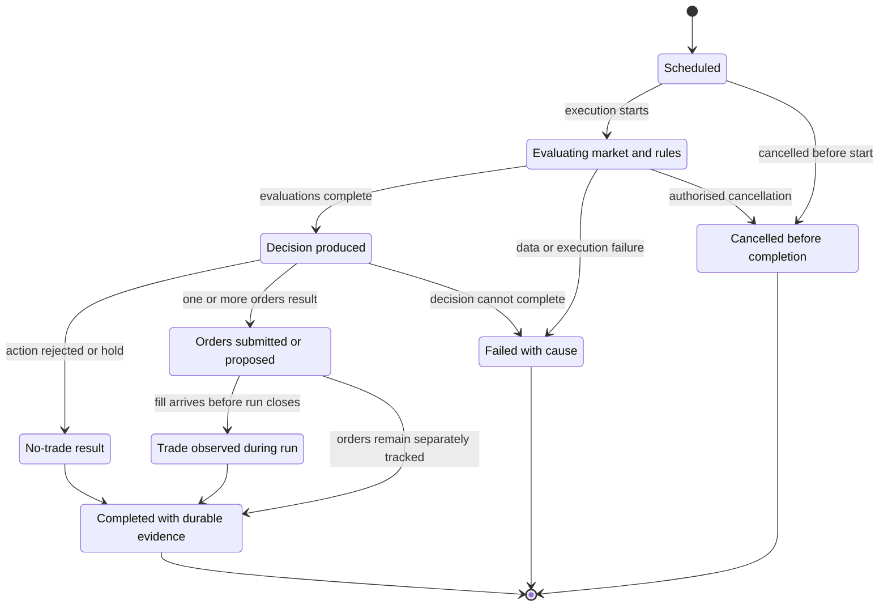

## 9. Portfolio Operational Lifecycle

Operational status communicates whether a portfolio can execute and whether displayed state is current. It must remain distinct from strategy performance.

```mermaid
stateDiagram-v2
    state "Provisioning" as Provisioning
    state "Active and current" as Active
    state "Paused for future executions" as Paused
    state "Degraded but connected" as Degraded
    state "Disconnected and stale" as Disconnected
    state "Reauthorizing and reconciling" as Reconciling
    state "Provisioning or operational failure" as Failed
    state "Finishing current run; no new runs scheduled" as Stopping
    state "Stopped" as Stopped
    state "Archived Paper evidence" as Archived

    [*] --> Provisioning
    Provisioning --> Active: ready
    Provisioning --> Failed: provisioning fails
    Failed --> Provisioning: safe retry
    Failed --> Stopped: abandon
    Active --> Paused: execution pause accepted
    Paused --> Active: resume accepted
    Active --> Degraded: partial service or stale dependency
    Degraded --> Active: recovered
    Active --> Disconnected: stream lost
    Degraded --> Disconnected: stream lost
    Paused --> Disconnected: stream lost
    Disconnected --> Reconciling: transport and authorization return
    Reconciling --> Active: snapshot and backfill converge
    Reconciling --> Paused: reconciled portfolio remains paused
    Reconciling --> Degraded: recovery incomplete
    Active --> Stopping: stop accepted during a run
    Active --> Stopped: stop accepted while idle
    Paused --> Stopped: stop accepted
    Degraded --> Stopping: stop accepted during a run
    Degraded --> Stopped: stop accepted while idle
    Stopping --> Stopped: current run reaches terminal state
    Stopped --> Archived: archive Paper
    Archived --> Stopped: unarchive; remain stopped
    Stopped --> [*]: close non-Paper history
```

Paper archive is deliberately two-step: an Active or Stopping portfolio cannot transition directly to Archived. Unarchive restores discoverability and historical inspection only; a separate explicit resume action is required before any future scheduled run.

The navigation status must preserve both entity existence and the underlying lifecycle through connection loss. `No portfolio` is not a state in this machine because no entity exists yet. `Disconnected` applies only after a portfolio exists and overlays its last confirmed lifecycle; recovery reconciles that same portfolio rather than creating a new one. Compact dots may reinforce these states, but persistent text carries the canonical meaning.

## 10. Live Emergency Controls

Pausing executions and cancelling orders are separate operations because each has a different scope and may succeed independently. Neither edits the strategy.

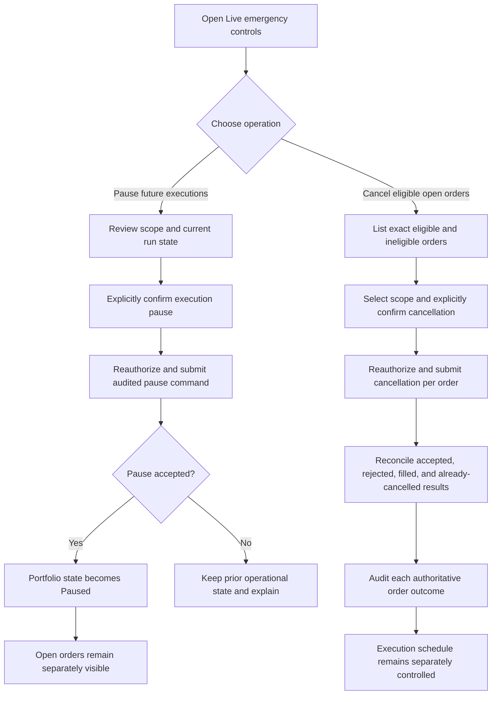

## 11. Authoritative Order Lifecycle

A cancellation request is not a cancellation, and an accepted order is not a trade. Each fill produces immutable trade evidence.

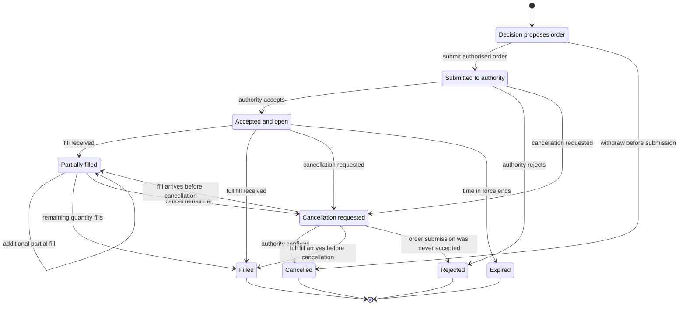

## 12. Provenance Graph

Every outcome remains traceable without pretending that every outcome includes an order or trade.

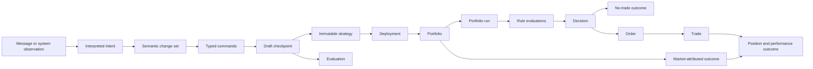

An evaluation may originate from a Draft checkpoint before Paper launch. A market-attributed outcome must not be presented as if the Champion directly caused the market movement.

## 13. Client State Ownership and Write Boundary

Reads flow down as snapshots, queries, and patches. Writes flow up as typed commands. The browser renders and recovers work; it does not define strategy or financial reality.

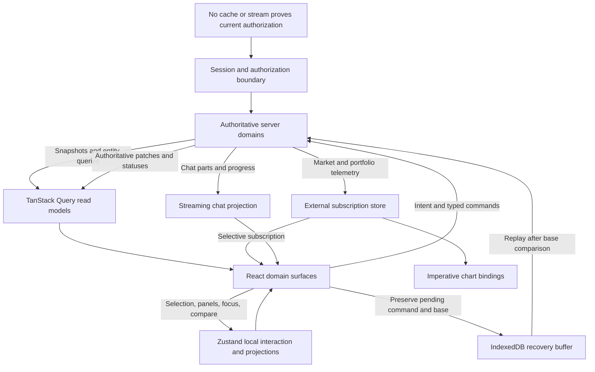

## 14. Performance Harness and Timing Path

The browser harness measures real render cost. Protocol load tests create backend pressure but do not substitute for event-to-paint measurement.

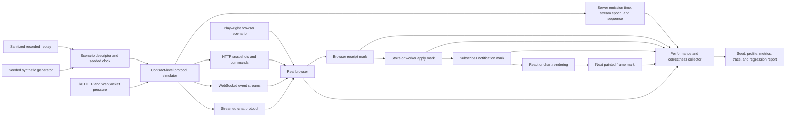

Command scenarios add submission, acknowledgement, authoritative result, patch receipt, and visible-confirmation marks. Ordering uses stream sequence and authoritative revision; timestamps measure latency and freshness.

## 15. Reconnect Correctness

The UI preserves last-known information with an explicit stale state. It does not present cached data as currently authorized or current.

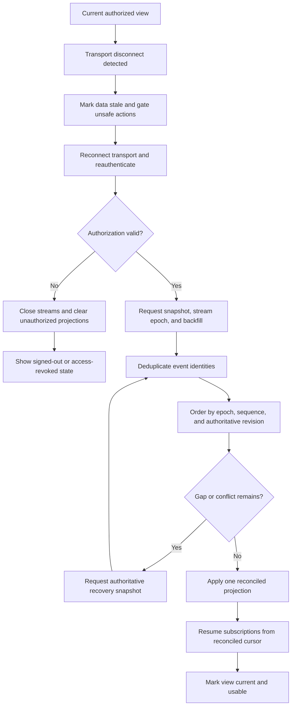

Under a deterministic scenario, the final portfolio, run, order, and chart state must equal uninterrupted replay without duplicate effects.

## 16. Champion Cache Tiers

Cache tier is a frontend performance policy, not a change in domain authority.

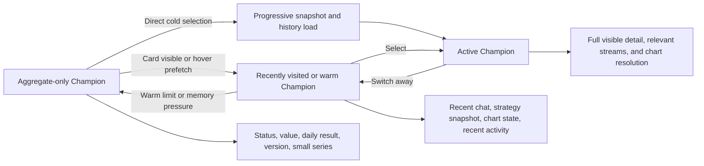

The active tier receives full visible detail. A bounded set of recently visited Champions stays warm. All others retain only aggregates. Hidden React views must still clean up effects and subscriptions explicitly.

Champion switching is a parent-context transition with a fail-closed interaction boundary:

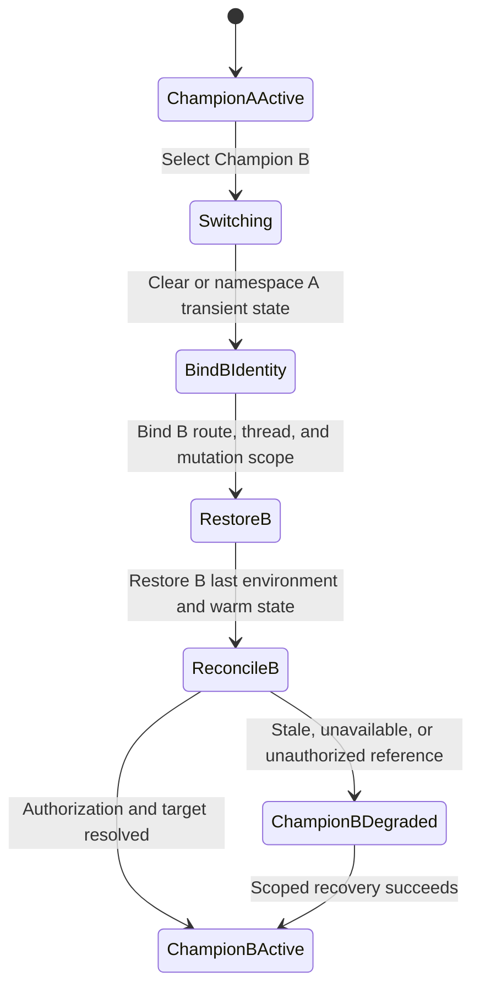

While `Switching`, strategy-changing submission is disabled. Champion A's conversation, mutation target, selected objects, optimistic projections, and financial facts cannot appear as Champion B state. `RestoreB` can use only Champion B namespaced state; a missing item becomes an explicit scoped empty/error state rather than a cross-Champion fallback.

## Diagram Validation Scenarios

The diagrams are internally consistent only if all of these statements remain true:

- Paper launch creates one immutable strategy and a new Draft generation without exposing partial active state.
- A rejected, failed, conflicted, offline, or cancelled change does not increment the Draft checkpoint.
- A user can follow Paper V5 evidence into Draft V8 at checkpoint V8.4 and create checkpoint V8.5 without altering or branching V5.
- A portfolio owns many runs; a run pins the exact deployment and immutable strategy active at its start.
- No-trade completes a run with durable evidence and no fabricated order.
- A Champion switch restores only the selected Champion's conversation, last environment, mutation target, and domain references; no prior-Champion interaction state leaks across the boundary.
- An order may complete after its originating run, and cancellation remains pending until authoritative confirmation.
- Pausing future executions does not imply that open orders were cancelled, and cancelling orders does not pause future runs.
- Failed Live activation leaves the previous Live deployment in control.
- Disconnects remain visibly stale until authorization, snapshot, and ordered backfill converge.
- Browser timing marks measure event-to-paint behavior without becoming event-order authority.
- Active, warm, and aggregate-only Champion tiers change retained client detail, not business state.
